# Scenic Flight

A Rust flight simulator for the round Waveshare ESP32-S3-Touch-AMOLED-1.75C. Pick an aircraft and watch it fly through a new procedural world.

[Play in browser](https://xberenguer.github.io/scenic-flight/play.html) · [Interactive gallery](https://xberenguer.github.io/scenic-flight/) · [Install on Waveshare](https://xn--sg8hhb.ws/flasher/?project=scenic-flight)

<!-- BEGIN GALLERY -->

## Gameplay showcase

Select a preview to open the full-size clip or screenshot.

<table>
  <tr>
    <td align="center"><a href="https://xberenguer.github.io/scenic-flight/assets/current/mountain-pass.mp4"></a><br>Mountain pass</td>
    <td align="center"><a href="https://xberenguer.github.io/scenic-flight/assets/current/coastal-soaring.mp4"></a><br>Eagle over the foothills</td>
    <td align="center"><a href="https://xberenguer.github.io/scenic-flight/assets/current/city-approach.mp4">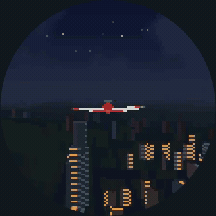</a><br>Racer approaching the skyline</td>
  </tr>
  <tr>
    <td align="center"><a href="https://xberenguer.github.io/scenic-flight/assets/current/high-cruise.mp4">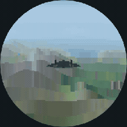</a><br>High-altitude cruise</td>
    <td align="center"><a href="https://xberenguer.github.io/scenic-flight/assets/current/river-valley.mp4">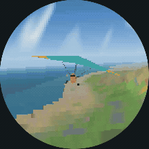</a><br>Ultralight over a river town</td>
  </tr>
</table>

### Biomes

<table>
  <tr>
    <td align="center"><a href="https://xberenguer.github.io/scenic-flight/assets/current/glider-coast.mp4">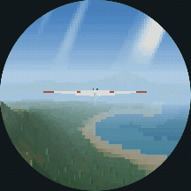</a><br>Glider on the coast</td>
    <td align="center"><a href="https://xberenguer.github.io/scenic-flight/assets/current/woodland-stands.mp4"></a><br>Bush Plane along the wooded slopes</td>
    <td align="center"><a href="https://xberenguer.github.io/scenic-flight/assets/current/bay-crossing.mp4"></a><br>Flight over the bay</td>
  </tr>
  <tr>
    <td align="center"><a href="docs/assets/current/cliffside.png"></a><br>Cliffside flight</td>
    <td align="center"><a href="docs/assets/current/bay-view.png"></a><br>Bay and headlands</td>
    <td align="center"><a href="docs/assets/current/ridge-view.png"></a><br>Ridge in daylight</td>
  </tr>
  <tr>
    <td align="center"><a href="docs/assets/current/coastal-sea-stack.png"></a><br>Sea stack</td>
    <td align="center"><a href="docs/assets/current/coastal-skerries.png"></a><br>Skerries</td>
    <td align="center"><a href="docs/assets/current/coastal-stone-arch.png">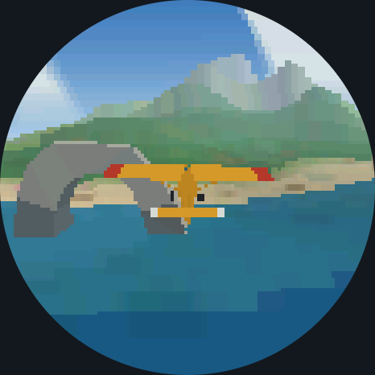</a><br>Sea arch</td>
  </tr>
  <tr>
    <td align="center"><a href="docs/assets/current/oxbow-lake.png">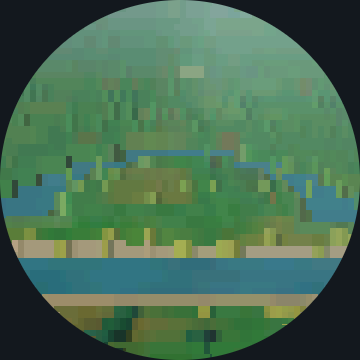</a><br>Oxbow lake</td>
    <td align="center"><a href="docs/assets/current/alpine-tarn.png"></a><br>Alpine tarn</td>
    <td align="center"><a href="docs/assets/current/columnar-rock.png">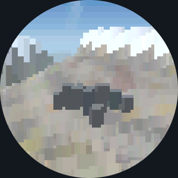</a><br>Columnar rock above an alpine scree slope</td>
  </tr>
  <tr>
    <td align="center"><a href="docs/assets/current/salt-pan.png"></a><br>Salt pan</td>
    <td align="center"><a href="docs/assets/current/inland-dunes.png">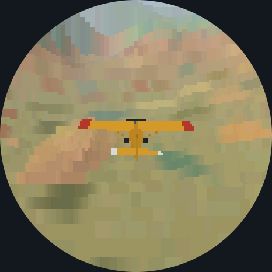</a><br>Inland dunes</td>
    <td align="center"><a href="docs/assets/current/badlands-ravine.png"></a><br>Badlands ravine</td>
  </tr>
  <tr>
    <td align="center"><a href="docs/assets/current/alluvial-fan.png"></a><br>Desert alluvial fan</td>
    <td align="center"><a href="docs/assets/current/cove-dune.png"></a><br>Cove dune</td>
    <td align="center"><a href="docs/assets/current/riverside-town.png"></a><br>River through the foothills</td>
  </tr>
  <tr>
    <td align="center"><a href="https://xberenguer.github.io/scenic-flight/assets/current/coastal-details-flight.mp4"></a><br>Bald eagle along the sandy coast</td>
  </tr>
</table>

### Built World

<table>
  <tr>
    <td align="center"><a href="https://xberenguer.github.io/scenic-flight/assets/current/marina-piers.mp4"></a><br>Marina and sailboats</td>
    <td align="center"><a href="https://xberenguer.github.io/scenic-flight/assets/current/ferry-terminal.mp4">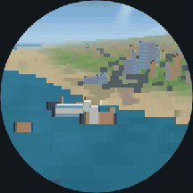</a><br>Ferry terminal</td>
    <td align="center"><a href="https://xberenguer.github.io/scenic-flight/assets/current/freight-containers.gif"></a><br>Container train below the Ultralight</td>
  </tr>
  <tr>
    <td align="center"><a href="docs/assets/current/freight-tankers.png"></a><br>Food-oil tank cars</td>
    <td align="center"><a href="docs/assets/current/freight-cold-storage.png"></a><br>Frozen-food reefers</td>
    <td align="center"><a href="docs/assets/current/freight-steel-coils.png">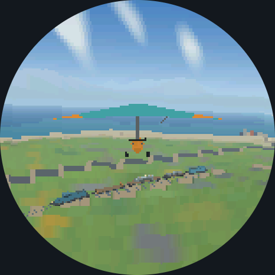</a><br>Steel coils and machinery freight</td>
  </tr>
  <tr>
    <td align="center"><a href="docs/assets/current/freight-platforms.png">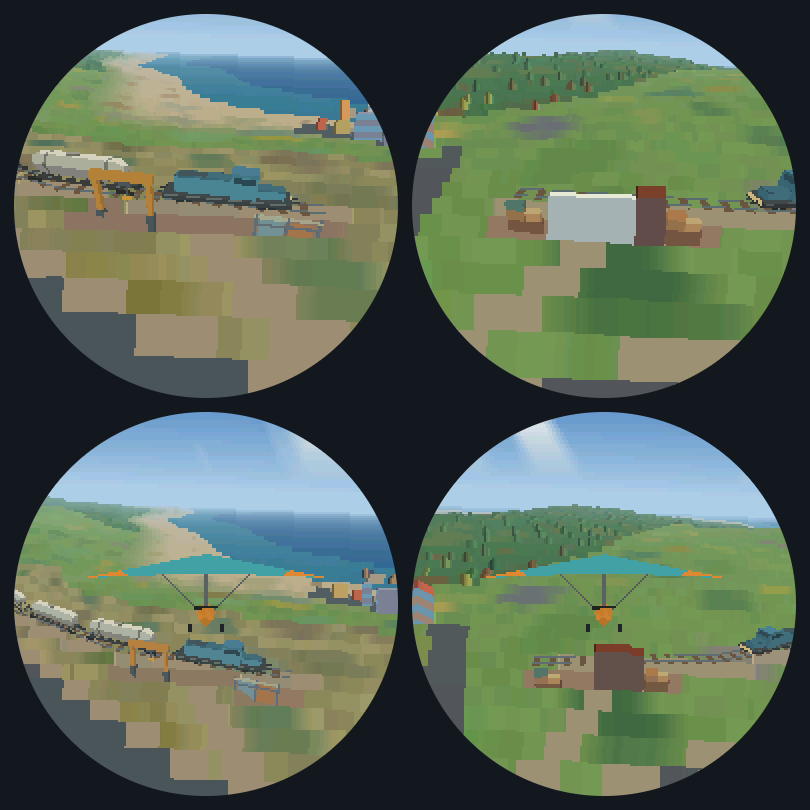</a><br>Rail loading apron and inland transfer shed</td>
    <td align="center"><a href="docs/assets/current/freight-loading.png"></a><br>Gravel and container loading aprons</td>
    <td align="center"><a href="https://xberenguer.github.io/scenic-flight/assets/current/grain-terminal.gif">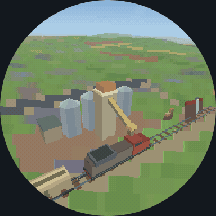</a><br>Rural grain elevator and hopper train</td>
  </tr>
  <tr>
    <td align="center"><a href="docs/assets/current/contour-fields.png"></a><br>Contour strips and grass buffers</td>
    <td align="center"><a href="docs/assets/current/gravel-freight.png"></a><br>Gravel pit and aggregate freight</td>
    <td align="center"><a href="docs/assets/current/aggregate-service.png"></a><br>Loaded gravel train and empty return</td>
  </tr>
  <tr>
    <td align="center"><a href="docs/assets/current/rail-earthworks.png">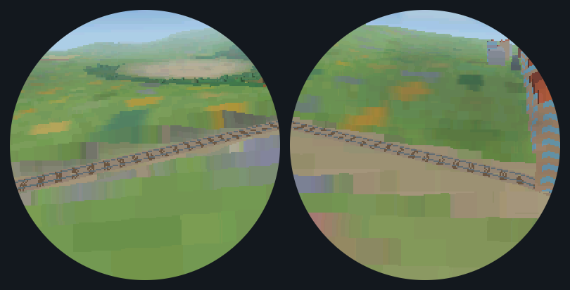</a><br>Rail cutting and gravel embankment</td>
    <td align="center"><a href="https://xberenguer.github.io/scenic-flight/assets/current/freight-harbor.mp4"></a><br>Freight harbor</td>
    <td align="center"><a href="docs/assets/current/grass-airstrip.png"></a><br>Country airstrip</td>
  </tr>
  <tr>
    <td align="center"><a href="docs/assets/current/regional-airfield.png"></a><br>Regional airfield</td>
    <td align="center"><a href="docs/assets/current/river-road-bridge.png">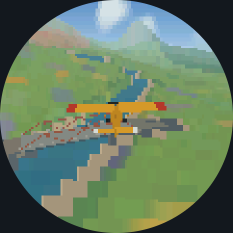</a><br>River road bridge</td>
    <td align="center"><a href="docs/assets/current/hillside-town.png"></a><br>Hillside town</td>
  </tr>
  <tr>
    <td align="center"><a href="docs/assets/current/coastal-lighthouse.png"></a><br>Coastal lighthouse</td>
    <td align="center"><a href="docs/assets/current/beach-umbrellas.png"></a><br>Beach umbrellas and towels</td>
    <td align="center"><a href="docs/assets/current/ferry-quayside.png">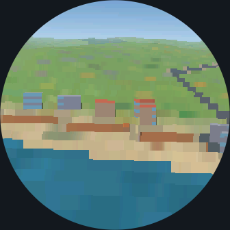</a><br>Ferry quay and workshops</td>
  </tr>
  <tr>
    <td align="center"><a href="docs/assets/current/river-boardwalk.png"></a><br>River boardwalk and lookout</td>
    <td align="center"><a href="docs/assets/current/coastal-boardwalk.png">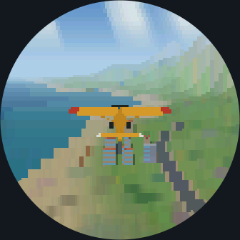</a><br>Coastal boardwalk village</td>
    <td align="center"><a href="https://xberenguer.github.io/scenic-flight/assets/current/farm-details-flyover.mp4"></a><br>Harvest equipment beside the fields</td>
  </tr>
  <tr>
    <td align="center"><a href="https://xberenguer.github.io/scenic-flight/assets/current/station-platform-preview.mp4"></a><br>Passenger station platform</td>
    <td align="center"><a href="https://xberenguer.github.io/scenic-flight/assets/current/freight-apron-preview.mp4"></a><br>Freight siding and loading apron</td>
    <td align="center"><a href="https://xberenguer.github.io/scenic-flight/assets/current/road-overlook.mp4">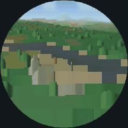</a><br>Mountain road overlook</td>
  </tr>
  <tr>
    <td align="center"><a href="https://xberenguer.github.io/scenic-flight/assets/current/woodland-trailhead.mp4">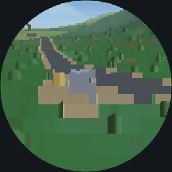</a><br>Woodland trailhead</td>
    <td align="center"><a href="https://xberenguer.github.io/scenic-flight/assets/current/road-rest-stop.mp4"></a><br>Roadside rest stop</td>
  </tr>
</table>

### Encounters

<table>
  <tr>
    <td align="center"><a href="https://xberenguer.github.io/scenic-flight/assets/current/fighter-afterburners.mp4">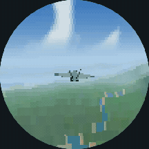</a><br>Fighter orange afterburner</td>
    <td align="center"><a href="https://xberenguer.github.io/scenic-flight/assets/current/blackbird-reheat.mp4"></a><br>Blackbird purple reheat</td>
    <td align="center"><a href="https://xberenguer.github.io/scenic-flight/assets/current/formation-pair.mp4"></a><br>Fighter line abreast</td>
  </tr>
  <tr>
    <td align="center"><a href="https://xberenguer.github.io/scenic-flight/assets/current/formation-four.mp4">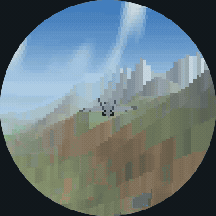</a><br>Fighter wedge · 4 wingmates</td>
    <td align="center"><a href="https://xberenguer.github.io/scenic-flight/assets/current/formation-echelon.mp4"></a><br>Fighter echelon and peel-away</td>
    <td align="center"><a href="https://xberenguer.github.io/scenic-flight/assets/current/blackbird-refueling.mp4"></a><br>Blackbird refueling</td>
  </tr>
</table>

### Aircraft

<table>
  <tr>
    <td align="center"><a href="https://xberenguer.github.io/scenic-flight/assets/current/glider-reflection.gif">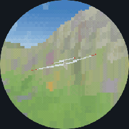</a><br>Sun glint in a thermal turn</td>
    <td align="center"><a href="https://xberenguer.github.io/scenic-flight/assets/current/racer-bank.mp4"></a><br>Racer banks around a ridge</td>
  </tr>
</table>

### Sky & Weather

<table>
  <tr>
    <td align="center"><a href="docs/assets/current/dusk-sky.png"></a><br>Moon over the city</td>
    <td align="center"><a href="docs/assets/current/shower-rainbow.png"></a><br>Rainbow in a coastal shower</td>
  </tr>
</table>

### Interface

<table>
  <tr>
    <td align="center"><a href="docs/assets/current/new-world-ui.png">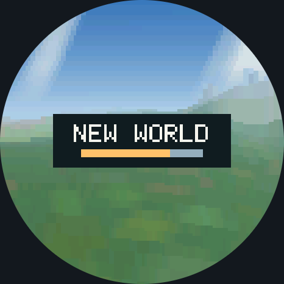</a><br>New World hold progress</td>
    <td align="center"><a href="docs/assets/current/flight-info.png"></a><br>Flight information overlay</td>
  </tr>
</table>

## Artwork gallery

### Aircraft and picker screens

<table>
  <tr>
    <td align="center"><a href="docs/assets/turntable-0.gif"></a><br><a href="docs/assets/picker-0.png"></a><br>Bush Plane</td>
    <td align="center"><a href="docs/assets/turntable-1.gif">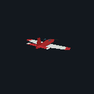</a><br><a href="docs/assets/picker-1.png"></a><br>Racer</td>
    <td align="center"><a href="docs/assets/turntable-2.gif"></a><br><a href="docs/assets/picker-2.png"></a><br>Sport Jet</td>
    <td align="center"><a href="docs/assets/turntable-3.gif"></a><br><a href="docs/assets/picker-3.png"></a><br>Ultralight</td>
  </tr>
</table>

<table>
  <tr>
    <td align="center"><a href="docs/assets/turntable-4.gif">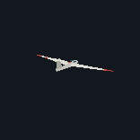</a><br><a href="docs/assets/picker-4.png">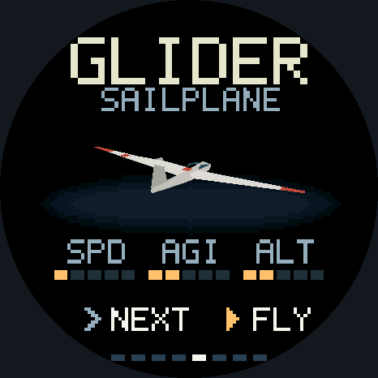</a><br>Glider</td>
    <td align="center"><a href="docs/assets/turntable-5.gif">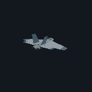</a><br><a href="docs/assets/picker-5.png">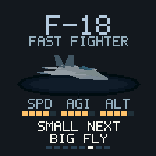</a><br>F/A-18 Fighter</td>
    <td align="center"><a href="docs/assets/turntable-6.gif">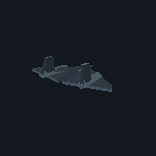</a><br><a href="docs/assets/picker-6.png"></a><br>SR-71 Blackbird</td>
    <td align="center"><a href="docs/assets/turntable-7.gif">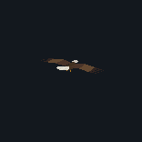</a><br><a href="docs/assets/picker-7.png">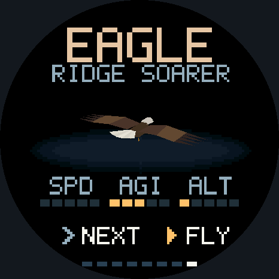</a><br>Bald Eagle</td>
  </tr>
</table>

### Scenery sprites

#### Roadside models · 30 variants

<a href="docs/assets/artwork/roadside-models.png"></a>

<a href="docs/assets/artwork/roadside-models.gif"></a>

#### Harbor models · 30 variants

<a href="docs/assets/artwork/harbor-models.png"></a>

<a href="docs/assets/artwork/harbor-models.gif"></a>

#### Railway fixtures · 25 variants

<a href="docs/assets/artwork/rail-stations.png"></a>

<a href="docs/assets/artwork/rail-stations.gif">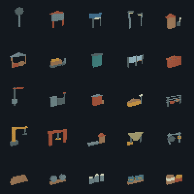</a>

#### Farm details · 25 variants

<a href="docs/assets/artwork/farm-details.png"></a>

<a href="docs/assets/artwork/farm-details.gif"></a>

#### Coastal details · 25 variants

<a href="docs/assets/artwork/coastal-details.png"></a>

<a href="docs/assets/artwork/coastal-details.gif">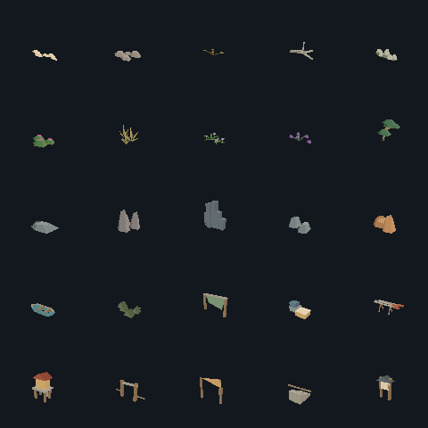</a>

#### Skyline landmarks · 25 variants

<a href="docs/assets/artwork/skyline-landmarks.png">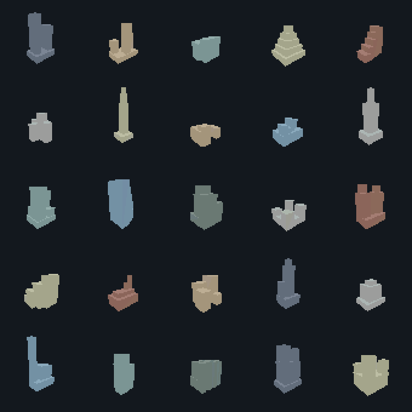</a>

<a href="docs/assets/artwork/skyline-landmarks.gif">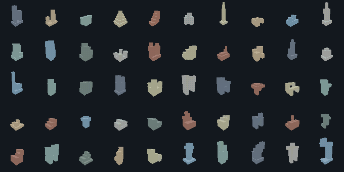</a>

#### Neighborhood buildings · 27 variants

<a href="docs/assets/artwork/neighborhood-buildings.png">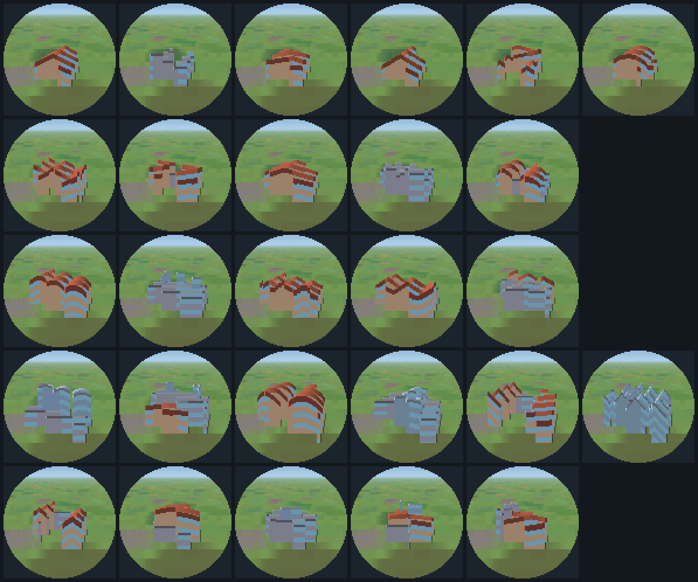</a>

#### Habitat details · 30 variants

<a href="docs/assets/artwork/habitat-details.png"></a>

#### City towers · 250 variants

<a href="docs/assets/artwork/towers.png"></a>

#### Trees · 256 variants

<a href="docs/assets/artwork/trees.png"></a>

#### Rocks · 256 variants

<a href="docs/assets/artwork/rocks.png"></a>

#### Bushes · 256 variants

<a href="docs/assets/artwork/bushes.png">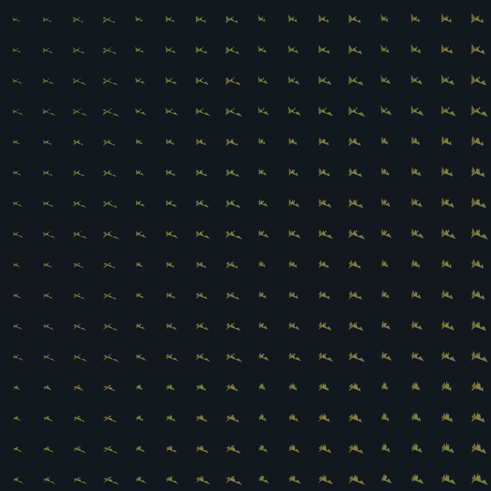</a>

#### Cacti · 256 variants

<a href="docs/assets/artwork/cacti.png">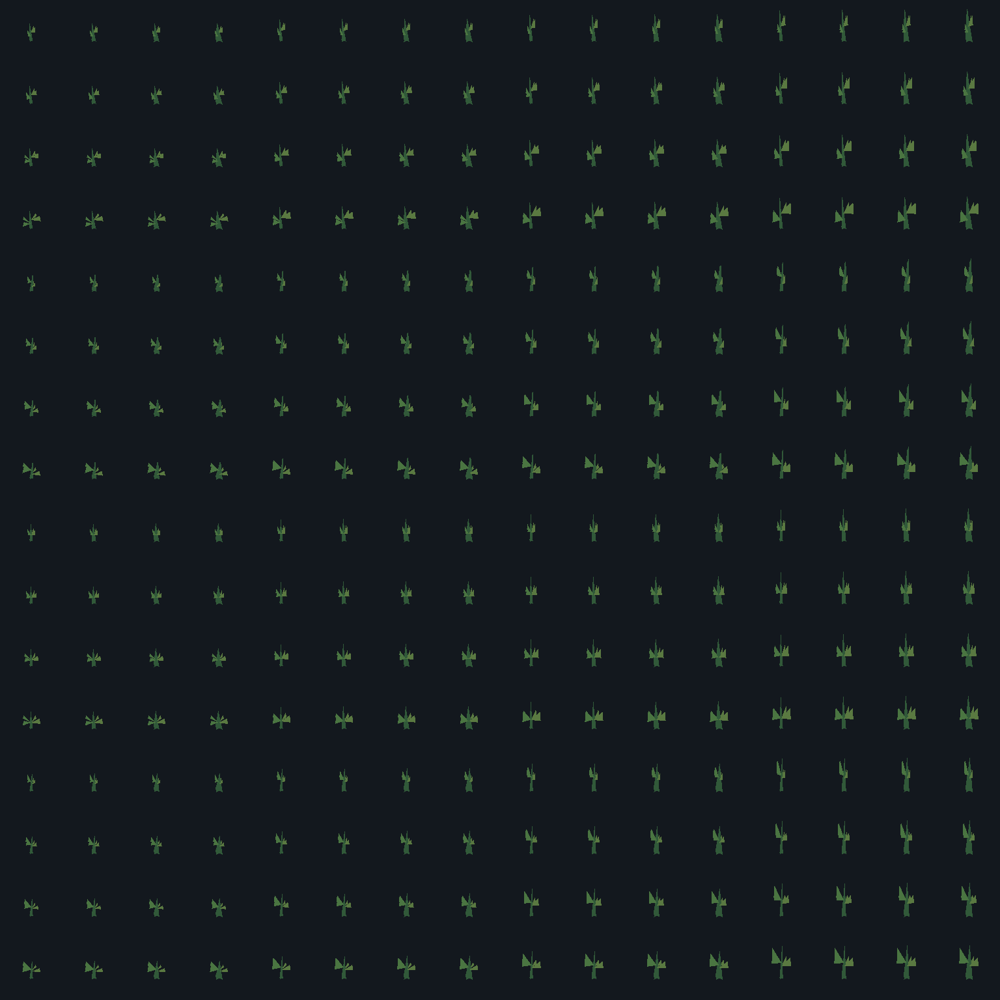</a>

#### Freight wagons · 250 variants

<a href="docs/assets/artwork/wagons.png">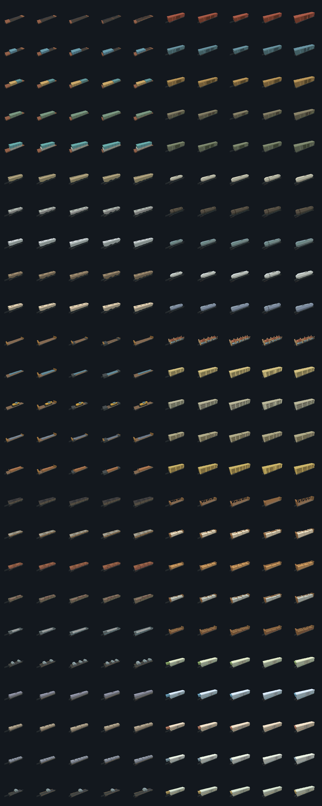</a>

#### Vessels · 250 variants

<a href="docs/assets/artwork/vessels.png"></a>

#### Wetland plants · 256 variants

<a href="docs/assets/artwork/wetlands.png">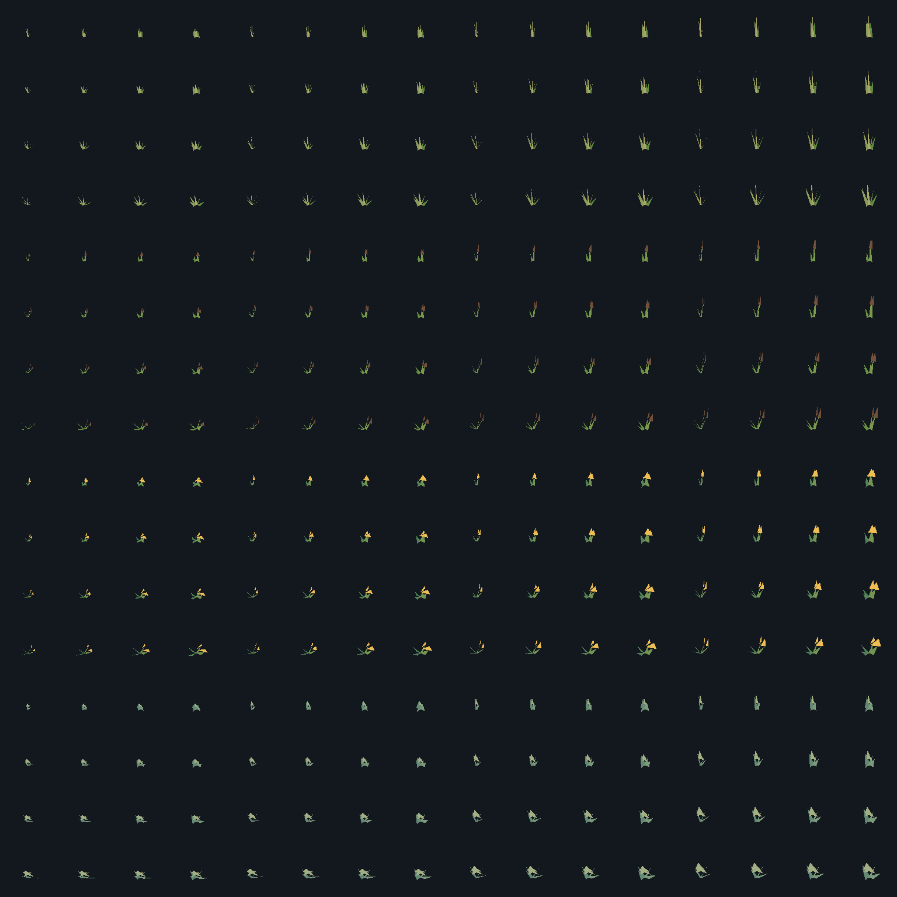</a>

#### Lighthouse forms · 3 variants

<a href="docs/assets/artwork/lighthouses.png">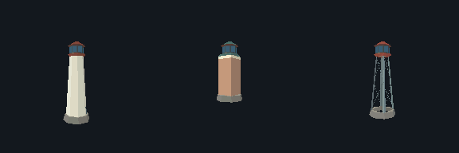</a>

#### Locomotives · 6 variants

<a href="docs/assets/artwork/locomotives.png"></a>

#### Waterfront landmarks · 4 variants

<a href="docs/assets/artwork/waterfront-landmarks.png">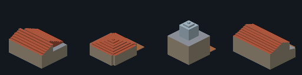</a>

<!-- END GALLERY -->

## Controls

| When | Small button | Large button |
| --- | --- | --- |
| Aircraft picker | Browse the eight aircraft | Take off |
| In flight | Tap for flight info. Hold until the progress bar fills to return to the picker and start a new world. | — |

The first picker launches a random aircraft after ten seconds if no buttons are pressed.

## Aircraft

| Aircraft | Flight style |
| --- | --- |
| Bush Plane | Low, deliberate flying and early climbs around ridges |
| Racer | Tighter turns over lowland terrain |
| Sport Jet | Smooth jet handling and occasional coastal passes |
| Ultralight | Slow sightseeing and occasional train follows |
| Glider | Thermal circles, ridge lift and downdrafts |
| F/A-18 Fighter | Formation flybys and short orange reheat bursts |
| SR-71 Blackbird | High cruise, purple reheat and a rare refueling rendezvous |
| Bald Eagle | Low soaring, measured wingbeats and occasional train follows |

## Install and build

Generate the scenery artwork directly from the game’s geometry with `./tools/export-artwork.sh`. The freight gallery shows 250 cars across 10 equipment families. Each car has a named load or return assignment, an explanation of its equipment, and a reference to the real railcars it draws on.

[Open the firmware flasher](https://xn--sg8hhb.ws/flasher/?project=scenic-flight) for compatible round Waveshare units. See the [latest GitHub release](https://github.com/xberenguer/scenic-flight/releases/latest) for the firmware and checksum.

Test the Rust simulation and render a seeded desktop frame.

```sh
cargo test --locked --features terrain-fork,small-raster-ray-budget,ground-cover
cargo run --locked --release --features ground-cover --bin flight-preview -- render 11 6 10 0.46 240 preview.ppm detailed
```

The Waveshare app is built with `board/build-app.sh` using an ESP32-S3 Xtensa Rust toolchain. See the [board build notes](board/BUILD-NOTES.md) for the toolchain and app partition details.

Original inspiration: [Voxel Flight by lewtheegg](https://github.com/lewtheegg/voxel-flight).
