# Scenic Flight

A Rust flight simulator for the round Waveshare ESP32-S3-Touch-AMOLED-1.75C. Pick an aircraft and watch it fly through a new procedural world.

[Play in browser](https://xberenguer.github.io/scenic-flight/play.html) · [Interactive gallery](https://xberenguer.github.io/scenic-flight/) · [Install on Waveshare](https://xn--sg8hhb.ws/flasher/?project=scenic-flight)

<!-- BEGIN GALLERY -->

## Gameplay showcase

Select a preview to open the full-size clip or screenshot.

<table>
  <tr>
    <td align="center"><a href="https://xberenguer.github.io/scenic-flight/assets/current/airfield-visitor-stands.mp4"></a><br><a href="docs/assets/current/airfield-visitor-stands.png">Still</a><br>Racer approaching a regional airfield</td>
    <td align="center"><a href="https://xberenguer.github.io/scenic-flight/assets/current/sedge-strand-tarn.mp4"></a><br><a href="docs/assets/current/sedge-strand-tarn.png">Still</a><br>Bald Eagle over a sedge-lined tarn</td>
    <td align="center"><a href="https://xberenguer.github.io/scenic-flight/assets/current/lantern-causeway-skyline.mp4">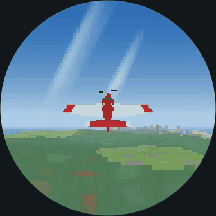</a><br><a href="docs/assets/current/lantern-causeway-skyline.png">Still</a><br>Racer approaching Lantern Causeway</td>
  </tr>
  <tr>
    <td align="center"><a href="https://xberenguer.github.io/scenic-flight/assets/current/high-cruise.mp4"></a><br><a href="docs/assets/current/high-cruise.png">Still</a><br>High-altitude cruise</td>
    <td align="center"><a href="https://xberenguer.github.io/scenic-flight/assets/current/quay-customs-annex.mp4">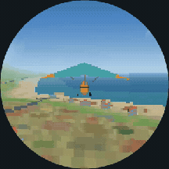</a><br><a href="docs/assets/current/quay-customs-annex.png">Still</a><br>Ultralight past the harbor customs annex</td>
  </tr>
</table>

### Biomes

<table>
  <tr>
    <td align="center"><a href="https://xberenguer.github.io/scenic-flight/assets/current/twin-cove-crests.mp4">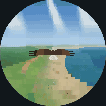</a><br><a href="docs/assets/current/twin-cove-crests.png">Still</a><br>Bald Eagle over twin dune crests</td>
    <td align="center"><a href="https://xberenguer.github.io/scenic-flight/assets/current/elbow-cove-dune.mp4">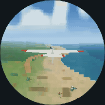</a><br><a href="docs/assets/current/elbow-cove-dune.png">Still</a><br>Glider following an elbow-shaped dune</td>
    <td align="center"><a href="https://xberenguer.github.io/scenic-flight/assets/current/notched-cove-dune.mp4">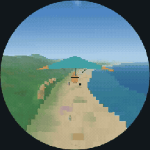</a><br><a href="docs/assets/current/notched-cove-dune.png">Still</a><br>Ultralight along a notched cove dune</td>
  </tr>
  <tr>
    <td align="center"><a href="https://xberenguer.github.io/scenic-flight/assets/current/twin-rock-buttresses.mp4">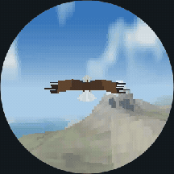</a><br><a href="docs/assets/current/twin-rock-buttresses.png">Still</a><br>Bald Eagle above twin rock buttresses</td>
    <td align="center"><a href="https://xberenguer.github.io/scenic-flight/assets/current/descending-columnar-wall.mp4">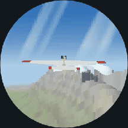</a><br><a href="docs/assets/current/descending-columnar-wall.png">Still</a><br>Glider over a descending rock face</td>
    <td align="center"><a href="https://xberenguer.github.io/scenic-flight/assets/current/fallen-columnar-blocks.mp4">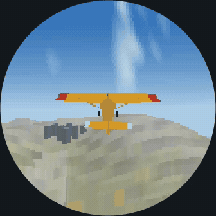</a><br><a href="docs/assets/current/fallen-columnar-blocks.png">Still</a><br>Bush Plane past a broad columnar outcrop</td>
  </tr>
  <tr>
    <td align="center"><a href="https://xberenguer.github.io/scenic-flight/assets/current/late-split-alluvial-fan.mp4"></a><br><a href="docs/assets/current/late-split-alluvial-fan.png">Still</a><br>Bald Eagle over a three-way desert wash</td>
    <td align="center"><a href="https://xberenguer.github.io/scenic-flight/assets/current/narrow-alluvial-fan.mp4"></a><br><a href="docs/assets/current/narrow-alluvial-fan.png">Still</a><br>Glider above a narrow alluvial fan</td>
    <td align="center"><a href="https://xberenguer.github.io/scenic-flight/assets/current/wide-gravel-fan.mp4">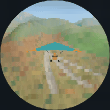</a><br><a href="docs/assets/current/wide-gravel-fan.png">Still</a><br>Ultralight over a wide gravel apron</td>
  </tr>
  <tr>
    <td align="center"><a href="https://xberenguer.github.io/scenic-flight/assets/current/broad-glacial-debris-apron.mp4"></a><br><a href="docs/assets/current/broad-glacial-debris-apron.png">Still</a><br>Ultralight past a broad moraine apron</td>
    <td align="center"><a href="https://xberenguer.github.io/scenic-flight/assets/current/sinuous-glacial-moraine.mp4">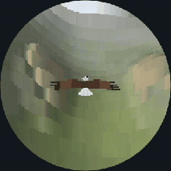</a><br><a href="docs/assets/current/sinuous-glacial-moraine.png">Still</a><br>Bald Eagle over a sinuous moraine</td>
    <td align="center"><a href="https://xberenguer.github.io/scenic-flight/assets/current/twin-recessional-ridges.mp4"></a><br><a href="docs/assets/current/twin-recessional-ridges.png">Still</a><br>Glider over twin moraine ridges</td>
  </tr>
  <tr>
    <td align="center"><a href="https://xberenguer.github.io/scenic-flight/assets/current/gravel-shoulder-tarn.mp4">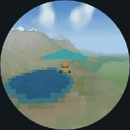</a><br><a href="docs/assets/current/gravel-shoulder-tarn.png">Still</a><br>Ultralight over a tarn with gravel shoulders</td>
    <td align="center"><a href="https://xberenguer.github.io/scenic-flight/assets/current/sand-fan-tarn.mp4">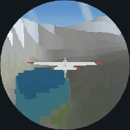</a><br><a href="docs/assets/current/sand-fan-tarn.png">Still</a><br>Glider past a sand-fan tarn</td>
    <td align="center"><a href="https://xberenguer.github.io/scenic-flight/assets/current/single-streak-moraine.mp4"></a><br><a href="docs/assets/current/single-streak-moraine.png">Still</a><br>Ultralight along a glacier moraine</td>
  </tr>
  <tr>
    <td align="center"><a href="https://xberenguer.github.io/scenic-flight/assets/current/bowed-blue-icefall.mp4">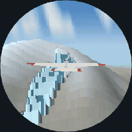</a><br><a href="docs/assets/current/bowed-blue-icefall.png">Still</a><br>Glider over a bowed blue icefall</td>
    <td align="center"><a href="https://xberenguer.github.io/scenic-flight/assets/current/tapered-snow-apron.mp4">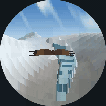</a><br><a href="docs/assets/current/tapered-snow-apron.png">Still</a><br>Bald Eagle above a tapered snow apron</td>
    <td align="center"><a href="https://xberenguer.github.io/scenic-flight/assets/current/stone-crown-island.mp4"></a><br><a href="docs/assets/current/stone-crown-island.png">Still</a><br>Ultralight over a two-crown shingle island</td>
  </tr>
  <tr>
    <td align="center"><a href="https://xberenguer.github.io/scenic-flight/assets/current/meadow-knoll-island.mp4">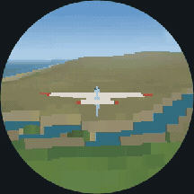</a><br><a href="docs/assets/current/meadow-knoll-island.png">Still</a><br>Glider past twin meadow knolls</td>
    <td align="center"><a href="https://xberenguer.github.io/scenic-flight/assets/current/crescent-river-island.mp4"></a><br><a href="docs/assets/current/crescent-river-island.png">Still</a><br>Bald Eagle over a sandy crescent island</td>
    <td align="center"><a href="https://xberenguer.github.io/scenic-flight/assets/current/thin-stone-bridge.mp4">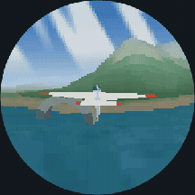</a><br><a href="docs/assets/current/thin-stone-bridge.png">Still</a><br>Glider by a thin sea arch</td>
  </tr>
  <tr>
    <td align="center"><a href="https://xberenguer.github.io/scenic-flight/assets/current/descending-skerries.mp4"></a><br><a href="docs/assets/current/descending-skerries.png">Still</a><br>Ultralight over descending skerries</td>
    <td align="center"><a href="https://xberenguer.github.io/scenic-flight/assets/current/needle-sea-stack.mp4">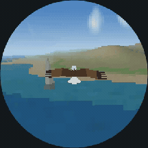</a><br><a href="docs/assets/current/needle-sea-stack.png">Still</a><br>Bald Eagle past a needle sea stack</td>
    <td align="center"><a href="https://xberenguer.github.io/scenic-flight/assets/current/mesa-three-towers.mp4">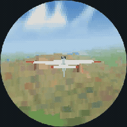</a><br><a href="docs/assets/current/mesa-three-towers.png">Still</a><br>Glider approaching three sandstone towers</td>
  </tr>
  <tr>
    <td align="center"><a href="https://xberenguer.github.io/scenic-flight/assets/current/mesa-ravine.mp4">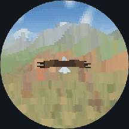</a><br><a href="docs/assets/current/mesa-ravine.png">Still</a><br>Bald Eagle along a sandstone ravine</td>
    <td align="center"><a href="https://xberenguer.github.io/scenic-flight/assets/current/mesa-double-ledge.mp4"></a><br><a href="docs/assets/current/mesa-double-ledge.png">Still</a><br>Ultralight over terraced sandstone mesas</td>
    <td align="center"><a href="https://xberenguer.github.io/scenic-flight/assets/current/flowering-reed-marsh.mp4"></a><br><a href="docs/assets/current/flowering-reed-marsh.png">Still</a><br>Ultralight along a reed marsh</td>
  </tr>
  <tr>
    <td align="center"><a href="https://xberenguer.github.io/scenic-flight/assets/current/floodplain-bend.mp4"></a><br><a href="docs/assets/current/floodplain-bend.png">Still</a><br>Ultralight along a floodplain bend</td>
    <td align="center"><a href="https://xberenguer.github.io/scenic-flight/assets/current/eagle-wet-meadow.mp4">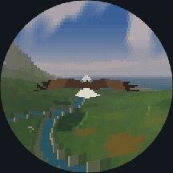</a><br><a href="docs/assets/current/eagle-wet-meadow.png">Still</a><br>Bald Eagle over a wet meadow</td>
    <td align="center"><a href="https://xberenguer.github.io/scenic-flight/assets/current/glacier-ice-pass.mp4">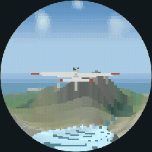</a><br><a href="docs/assets/current/glacier-ice-pass.png">Still</a><br>Glider above fractured ice</td>
  </tr>
  <tr>
    <td align="center"><a href="https://xberenguer.github.io/scenic-flight/assets/current/alpine-ridgetop.mp4"></a><br><a href="docs/assets/current/alpine-ridgetop.png">Still</a><br>Bush Plane over a rocky alpine ridge</td>
    <td align="center"><a href="https://xberenguer.github.io/scenic-flight/assets/current/alpine-rock-and-meadow.mp4">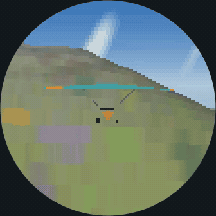</a><br><a href="docs/assets/current/alpine-rock-and-meadow.png">Still</a><br>Ultralight over an alpine meadow</td>
    <td align="center"><a href="https://xberenguer.github.io/scenic-flight/assets/current/glider-upper-shore.mp4"></a><br><a href="docs/assets/current/glider-upper-shore.png">Still</a><br>Glider over coastal grasses</td>
  </tr>
  <tr>
    <td align="center"><a href="https://xberenguer.github.io/scenic-flight/assets/current/eagle-headland.mp4"></a><br><a href="docs/assets/current/eagle-headland.png">Still</a><br>Bald Eagle along a sandy headland</td>
    <td align="center"><a href="https://xberenguer.github.io/scenic-flight/assets/current/grassland-coastal-slopes.mp4">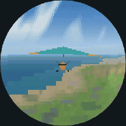</a><br><a href="docs/assets/current/grassland-coastal-slopes.png">Still</a><br>Ultralight along coastal grassland</td>
    <td align="center"><a href="https://xberenguer.github.io/scenic-flight/assets/current/grassland-foothills.mp4">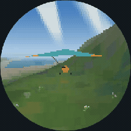</a><br><a href="docs/assets/current/grassland-foothills.png">Still</a><br>Ultralight over grassy foothills</td>
  </tr>
  <tr>
    <td align="center"><a href="https://xberenguer.github.io/scenic-flight/assets/current/coastal-details-flight.mp4"></a><br><a href="docs/assets/current/coastal-details-flight.png">Still</a><br>Bald eagle along the sandy coast</td>
    <td align="center"><a href="docs/assets/current/riverside-town.png">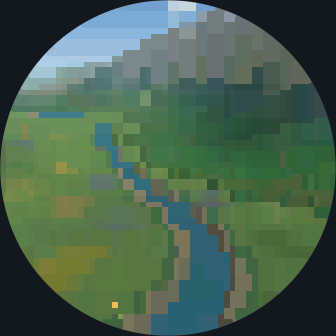</a><br>River through the foothills</td>
    <td align="center"><a href="docs/assets/current/cove-dune.png"></a><br>Cove dune</td>
  </tr>
  <tr>
    <td align="center"><a href="docs/assets/current/alluvial-fan.png"></a><br>Desert alluvial fan</td>
    <td align="center"><a href="docs/assets/current/badlands-ravine.png"></a><br>Badlands ravine</td>
    <td align="center"><a href="docs/assets/current/inland-dunes.png"></a><br>Inland dunes</td>
  </tr>
  <tr>
    <td align="center"><a href="docs/assets/current/salt-pan.png"></a><br>Salt pan</td>
    <td align="center"><a href="docs/assets/current/columnar-rock.png"></a><br>Columnar rock above an alpine scree slope</td>
    <td align="center"><a href="docs/assets/current/alpine-tarn.png"></a><br>Alpine tarn</td>
  </tr>
  <tr>
    <td align="center"><a href="docs/assets/current/oxbow-lake.png"></a><br>Oxbow lake</td>
    <td align="center"><a href="docs/assets/current/coastal-stone-arch.png"></a><br>Sea arch</td>
    <td align="center"><a href="docs/assets/current/coastal-skerries.png">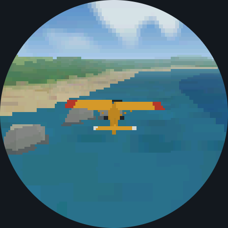</a><br>Skerries</td>
  </tr>
  <tr>
    <td align="center"><a href="docs/assets/current/coastal-sea-stack.png">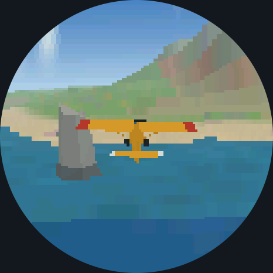</a><br>Sea stack</td>
    <td align="center"><a href="docs/assets/current/ridge-view.png"></a><br>Ridge in daylight</td>
    <td align="center"><a href="docs/assets/current/bay-view.png"></a><br>Bay and headlands</td>
  </tr>
  <tr>
    <td align="center"><a href="docs/assets/current/cliffside.png">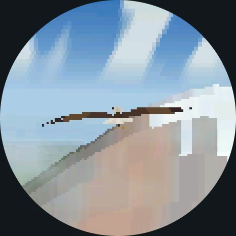</a><br>Cliffside flight</td>
    <td align="center"><a href="https://xberenguer.github.io/scenic-flight/assets/current/bay-crossing.mp4"></a><br><a href="docs/assets/current/bay-crossing.png">Still</a><br>Flight over the bay</td>
    <td align="center"><a href="https://xberenguer.github.io/scenic-flight/assets/current/woodland-stands.mp4">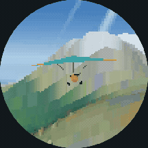</a><br><a href="docs/assets/current/woodland-stands.png">Still</a><br>Bush Plane along the wooded slopes</td>
  </tr>
  <tr>
    <td align="center"><a href="https://xberenguer.github.io/scenic-flight/assets/current/glider-coast.mp4"></a><br><a href="docs/assets/current/glider-coast.png">Still</a><br>Glider on the coast</td>
    <td align="center"><a href="https://xberenguer.github.io/scenic-flight/assets/current/river-valley.mp4"></a><br><a href="docs/assets/current/river-valley.png">Still</a><br>Ultralight over a river town</td>
    <td align="center"><a href="https://xberenguer.github.io/scenic-flight/assets/current/coastal-soaring.mp4"></a><br><a href="docs/assets/current/coastal-soaring.png">Still</a><br>Eagle over the foothills</td>
  </tr>
  <tr>
    <td align="center"><a href="https://xberenguer.github.io/scenic-flight/assets/current/mountain-pass.mp4">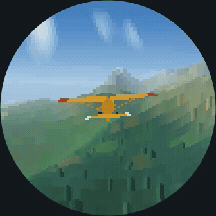</a><br><a href="docs/assets/current/mountain-pass.png">Still</a><br>Mountain pass</td>
    <td align="center"><a href="https://xberenguer.github.io/scenic-flight/assets/current/snowfield-glider.mp4"></a><br><a href="docs/assets/current/snowfield-glider.png">Still</a><br>Glider over a snowfield</td>
    <td align="center"><a href="https://xberenguer.github.io/scenic-flight/assets/current/ultralight-ridge.mp4">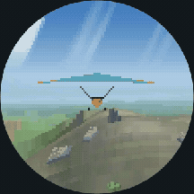</a><br><a href="docs/assets/current/ultralight-ridge.png">Still</a><br>Ultralight over a rocky ridge</td>
  </tr>
  <tr>
    <td align="center"><a href="https://xberenguer.github.io/scenic-flight/assets/current/wooded-watershed.mp4">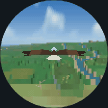</a><br><a href="docs/assets/current/wooded-watershed.png">Still</a><br>Eagle over a wooded watershed</td>
    <td align="center"><a href="https://xberenguer.github.io/scenic-flight/assets/current/reedbed-meander.mp4">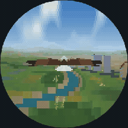</a><br><a href="docs/assets/current/reedbed-meander.png">Still</a><br>Eagle over a reed-lined bend</td>
    <td align="center"><a href="https://xberenguer.github.io/scenic-flight/assets/current/eagle-forest-edge.mp4"></a><br><a href="docs/assets/current/eagle-forest-edge.png">Still</a><br>Eagle along the forest edge</td>
  </tr>
  <tr>
    <td align="center"><a href="https://xberenguer.github.io/scenic-flight/assets/current/wooded-valley-pass.mp4"></a><br><a href="docs/assets/current/wooded-valley-pass.png">Still</a><br>Ultralight through a wooded valley</td>
    <td align="center"><a href="https://xberenguer.github.io/scenic-flight/assets/current/dryland-badlands-pass.mp4">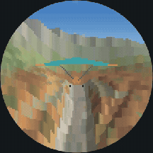</a><br><a href="docs/assets/current/dryland-badlands-pass.png">Still</a><br>Ultralight through the badlands</td>
    <td align="center"><a href="https://xberenguer.github.io/scenic-flight/assets/current/dryland-basin-pass.mp4">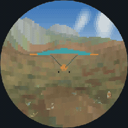</a><br><a href="docs/assets/current/dryland-basin-pass.png">Still</a><br>Ultralight over desert flats</td>
  </tr>
</table>

### Built World

<table>
  <tr>
    <td align="center"><a href="https://xberenguer.github.io/scenic-flight/assets/current/airfield-country-service-pocket.mp4">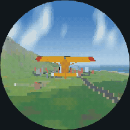</a><br><a href="docs/assets/current/airfield-country-service-pocket.png">Still</a><br>Bush Plane circling a country strip</td>
    <td align="center"><a href="https://xberenguer.github.io/scenic-flight/assets/current/airfield-light-aircraft-bays.mp4"></a><br><a href="docs/assets/current/airfield-light-aircraft-bays.png">Still</a><br>Glider over light-aircraft bays</td>
    <td align="center"><a href="https://xberenguer.github.io/scenic-flight/assets/current/narrow-inlet-quarry.mp4">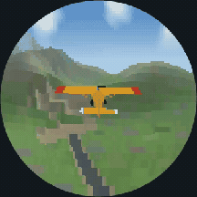</a><br><a href="docs/assets/current/narrow-inlet-quarry.png">Still</a><br>Bush Plane above a narrow quarry entrance</td>
  </tr>
  <tr>
    <td align="center"><a href="https://xberenguer.github.io/scenic-flight/assets/current/west-sweep-quarry.mp4">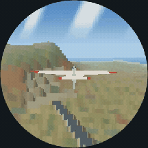</a><br><a href="docs/assets/current/west-sweep-quarry.png">Still</a><br>Glider past a sweeping cut and haul road</td>
    <td align="center"><a href="https://xberenguer.github.io/scenic-flight/assets/current/half-bowl-quarry.mp4">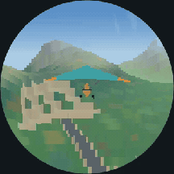</a><br><a href="docs/assets/current/half-bowl-quarry.png">Still</a><br>Ultralight above a half-bowl quarry</td>
    <td align="center"><a href="https://xberenguer.github.io/scenic-flight/assets/current/quay-boatyard-paint-hall.mp4"></a><br><a href="docs/assets/current/quay-boatyard-paint-hall.png">Still</a><br>Bush Plane along the boatyard promenade</td>
  </tr>
  <tr>
    <td align="center"><a href="https://xberenguer.github.io/scenic-flight/assets/current/quay-twin-fish-sheds.mp4"></a><br><a href="docs/assets/current/quay-twin-fish-sheds.png">Still</a><br>Glider approaching twin fish sheds</td>
    <td align="center"><a href="https://xberenguer.github.io/scenic-flight/assets/current/market-gardens-below-town.mp4"></a><br><a href="docs/assets/current/market-gardens-below-town.png">Still</a><br>Ultralight over market gardens below town</td>
    <td align="center"><a href="https://xberenguer.github.io/scenic-flight/assets/current/coastal-stubble-fields.mp4">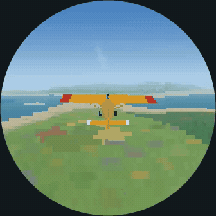</a><br><a href="docs/assets/current/coastal-stubble-fields.png">Still</a><br>Bush Plane over coastal stubble fields</td>
  </tr>
  <tr>
    <td align="center"><a href="https://xberenguer.github.io/scenic-flight/assets/current/grassy-field-setbacks.mp4">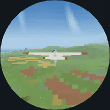</a><br><a href="docs/assets/current/grassy-field-setbacks.png">Still</a><br>Glider over fields with grassy setbacks</td>
    <td align="center"><a href="https://xberenguer.github.io/scenic-flight/assets/current/chamber-on-columns-skyline.mp4"></a><br><a href="docs/assets/current/chamber-on-columns-skyline.png">Still</a><br>Bush Plane approaching Chamber on Columns</td>
    <td align="center"><a href="https://xberenguer.github.io/scenic-flight/assets/current/library-of-steps-skyline.mp4">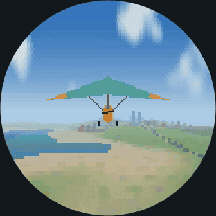</a><br><a href="docs/assets/current/library-of-steps-skyline.png">Still</a><br>Ultralight approaching the Library of Steps</td>
  </tr>
  <tr>
    <td align="center"><a href="https://xberenguer.github.io/scenic-flight/assets/current/glass-hourglass-skyline.mp4">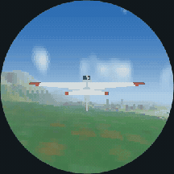</a><br><a href="docs/assets/current/glass-hourglass-skyline.png">Still</a><br>Glider approaching the Glass Hourglass</td>
    <td align="center"><a href="https://xberenguer.github.io/scenic-flight/assets/current/solar-three-islands.mp4"></a><br><a href="docs/assets/current/solar-three-islands.png">Still</a><br>Bush Plane over three banks of solar panels</td>
    <td align="center"><a href="https://xberenguer.github.io/scenic-flight/assets/current/solar-striped-field.mp4">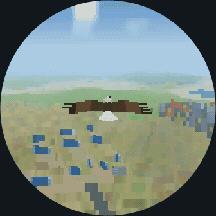</a><br><a href="docs/assets/current/solar-striped-field.png">Still</a><br>Bald Eagle over a striped solar field</td>
  </tr>
  <tr>
    <td align="center"><a href="https://xberenguer.github.io/scenic-flight/assets/current/solar-diamond-field.mp4"></a><br><a href="docs/assets/current/solar-diamond-field.png">Still</a><br>Glider over a diamond-shaped solar field</td>
    <td align="center"><a href="https://xberenguer.github.io/scenic-flight/assets/current/solar-service-court.mp4"></a><br><a href="docs/assets/current/solar-service-court.png">Still</a><br>Ultralight over a solar service court</td>
    <td align="center"><a href="https://xberenguer.github.io/scenic-flight/assets/current/splayed-portal-water-tower.mp4">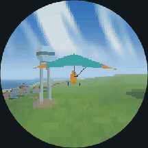</a><br><a href="docs/assets/current/splayed-portal-water-tower.png">Still</a><br>Ultralight past a splayed portal tank</td>
  </tr>
  <tr>
    <td align="center"><a href="https://xberenguer.github.io/scenic-flight/assets/current/copper-dome-water-tower.mp4">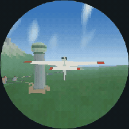</a><br><a href="docs/assets/current/copper-dome-water-tower.png">Still</a><br>Glider beside a masonry water tower</td>
    <td align="center"><a href="https://xberenguer.github.io/scenic-flight/assets/current/steel-frame-saucer-tower.mp4"></a><br><a href="docs/assets/current/steel-frame-saucer-tower.png">Still</a><br>Bald Eagle past a steel-frame water tower</td>
    <td align="center"><a href="https://xberenguer.github.io/scenic-flight/assets/current/green-pratt-crossing.mp4"></a><br><a href="docs/assets/current/green-pratt-crossing.png">Still</a><br>Ultralight alongside a green Pratt truss</td>
  </tr>
  <tr>
    <td align="center"><a href="https://xberenguer.github.io/scenic-flight/assets/current/cream-tied-arch.mp4"></a><br><a href="docs/assets/current/cream-tied-arch.png">Still</a><br>Glider past a tied-arch bridge</td>
    <td align="center"><a href="https://xberenguer.github.io/scenic-flight/assets/current/timber-crossing.mp4">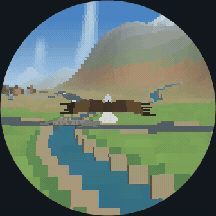</a><br><a href="docs/assets/current/timber-crossing.png">Still</a><br>Bald Eagle over a timber-braced crossing</td>
    <td align="center"><a href="https://xberenguer.github.io/scenic-flight/assets/current/paired-mountain-gondolas.mp4">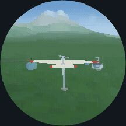</a><br><a href="docs/assets/current/paired-mountain-gondolas.png">Still</a><br>Glider alongside mountain gondolas</td>
  </tr>
  <tr>
    <td align="center"><a href="https://xberenguer.github.io/scenic-flight/assets/current/stone-cableway-landing.mp4"></a><br><a href="docs/assets/current/stone-cableway-landing.png">Still</a><br>Ultralight at a stone cableway landing</td>
    <td align="center"><a href="https://xberenguer.github.io/scenic-flight/assets/current/timber-cableway-terminal.mp4"></a><br><a href="docs/assets/current/timber-cableway-terminal.png">Still</a><br>Bald Eagle past a timber cableway terminal</td>
    <td align="center"><a href="https://xberenguer.github.io/scenic-flight/assets/current/open-frame-lighthouse-night.mp4">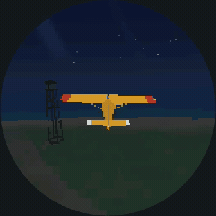</a><br><a href="docs/assets/current/open-frame-lighthouse-night.png">Still</a><br>Bush Plane past an open-frame lighthouse at night</td>
  </tr>
  <tr>
    <td align="center"><a href="https://xberenguer.github.io/scenic-flight/assets/current/green-cupola-lighthouse.mp4"></a><br><a href="docs/assets/current/green-cupola-lighthouse.png">Still</a><br>Ultralight by a green-cupola keeper tower</td>
    <td align="center"><a href="https://xberenguer.github.io/scenic-flight/assets/current/red-banded-lighthouse.mp4">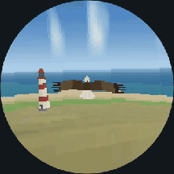</a><br><a href="docs/assets/current/red-banded-lighthouse.png">Still</a><br>Bald Eagle past a red-banded lighthouse</td>
    <td align="center"><a href="https://xberenguer.github.io/scenic-flight/assets/current/coach-rest-hall.mp4"></a><br><a href="docs/assets/current/coach-rest-hall.png">Still</a><br>Glider over a coach rest hall</td>
  </tr>
  <tr>
    <td align="center"><a href="https://xberenguer.github.io/scenic-flight/assets/current/stone-roadside-overlook.mp4"></a><br><a href="docs/assets/current/stone-roadside-overlook.png">Still</a><br>Ultralight past a stone overlook</td>
    <td align="center"><a href="https://xberenguer.github.io/scenic-flight/assets/current/forest-camp-check-in.mp4"></a><br><a href="docs/assets/current/forest-camp-check-in.png">Still</a><br>Eagle over a forest check-in kiosk</td>
    <td align="center"><a href="https://xberenguer.github.io/scenic-flight/assets/current/twin-stack-boiler-house.mp4"></a><br><a href="docs/assets/current/twin-stack-boiler-house.png">Still</a><br>Ultralight by a twin-stack boiler house</td>
  </tr>
  <tr>
    <td align="center"><a href="https://xberenguer.github.io/scenic-flight/assets/current/rail-workshops-flyover.mp4"></a><br><a href="docs/assets/current/rail-workshops-flyover.png">Still</a><br>Ultralight over railway workshops</td>
    <td align="center"><a href="https://xberenguer.github.io/scenic-flight/assets/current/tram-carhouse-flyover.mp4"></a><br><a href="docs/assets/current/tram-carhouse-flyover.png">Still</a><br>Ultralight above a tram carhouse</td>
    <td align="center"><a href="https://xberenguer.github.io/scenic-flight/assets/current/covered-market-court.mp4"></a><br><a href="docs/assets/current/covered-market-court.png">Still</a><br>Bald Eagle over a covered market court</td>
  </tr>
  <tr>
    <td align="center"><a href="https://xberenguer.github.io/scenic-flight/assets/current/coastal-grain-store.mp4"></a><br><a href="docs/assets/current/coastal-grain-store.png">Still</a><br>Ultralight passes a cooperative grain store</td>
    <td align="center"><a href="https://xberenguer.github.io/scenic-flight/assets/current/town-clock-tower.mp4"></a><br><a href="docs/assets/current/town-clock-tower.png">Still</a><br>Ultralight over a town hall clock tower</td>
    <td align="center"><a href="https://xberenguer.github.io/scenic-flight/assets/current/twin-summit-domes.mp4"></a><br><a href="docs/assets/current/twin-summit-domes.png">Still</a><br>Glider approaches twin summit observatories</td>
  </tr>
  <tr>
    <td align="center"><a href="https://xberenguer.github.io/scenic-flight/assets/current/cantilever-ridge-lookout.mp4"></a><br><a href="docs/assets/current/cantilever-ridge-lookout.png">Still</a><br>Bush plane passes a cantilevered ridge lookout</td>
    <td align="center"><a href="https://xberenguer.github.io/scenic-flight/assets/current/split-roof-summit-refuge.mp4"></a><br><a href="docs/assets/current/split-roof-summit-refuge.png">Still</a><br>Bush plane over a split-roof alpine refuge</td>
    <td align="center"><a href="https://xberenguer.github.io/scenic-flight/assets/current/island-landing-craft.mp4"></a><br><a href="docs/assets/current/island-landing-craft.png">Still</a><br>Bald Eagle passes an island landing craft</td>
  </tr>
  <tr>
    <td align="center"><a href="https://xberenguer.github.io/scenic-flight/assets/current/fish-farm-barge.mp4"></a><br><a href="docs/assets/current/fish-farm-barge.png">Still</a><br>Bald Eagle over a fish farm feeder barge</td>
    <td align="center"><a href="https://xberenguer.github.io/scenic-flight/assets/current/night-industrial-skyline.mp4"></a><br><a href="docs/assets/current/night-industrial-skyline.png">Still</a><br>Ultralight over the industrial skyline at night</td>
    <td align="center"><a href="https://xberenguer.github.io/scenic-flight/assets/current/linked-downtown.mp4"></a><br><a href="docs/assets/current/linked-downtown.png">Still</a><br>Ultralight approaching a linked downtown</td>
  </tr>
  <tr>
    <td align="center"><a href="https://xberenguer.github.io/scenic-flight/assets/current/road-rest-stop.mp4"></a><br><a href="docs/assets/current/road-rest-stop.png">Still</a><br>Roadside rest stop</td>
    <td align="center"><a href="https://xberenguer.github.io/scenic-flight/assets/current/woodland-trailhead.mp4"></a><br><a href="docs/assets/current/woodland-trailhead.png">Still</a><br>Woodland trailhead</td>
    <td align="center"><a href="https://xberenguer.github.io/scenic-flight/assets/current/road-overlook.mp4"></a><br><a href="docs/assets/current/road-overlook.png">Still</a><br>Mountain road overlook</td>
  </tr>
  <tr>
    <td align="center"><a href="https://xberenguer.github.io/scenic-flight/assets/current/freight-apron-preview.mp4"></a><br><a href="docs/assets/current/freight-apron-preview.png">Still</a><br>Freight siding and loading apron</td>
    <td align="center"><a href="https://xberenguer.github.io/scenic-flight/assets/current/station-platform-preview.mp4"></a><br><a href="docs/assets/current/station-platform-preview.png">Still</a><br>Passenger station platform</td>
    <td align="center"><a href="https://xberenguer.github.io/scenic-flight/assets/current/farm-details-flyover.mp4"></a><br><a href="docs/assets/current/farm-details-flyover.png">Still</a><br>Harvest equipment beside the fields</td>
  </tr>
  <tr>
    <td align="center"><a href="docs/assets/current/coastal-boardwalk.png"></a><br>Coastal boardwalk village</td>
    <td align="center"><a href="docs/assets/current/river-boardwalk.png"></a><br>River boardwalk and lookout</td>
    <td align="center"><a href="docs/assets/current/ferry-quayside.png"></a><br>Ferry quay and workshops</td>
  </tr>
  <tr>
    <td align="center"><a href="docs/assets/current/beach-umbrellas.png"></a><br>Beach umbrellas and towels</td>
    <td align="center"><a href="docs/assets/current/coastal-lighthouse.png"></a><br>Coastal lighthouse</td>
    <td align="center"><a href="docs/assets/current/hillside-town.png"></a><br>Hillside town</td>
  </tr>
  <tr>
    <td align="center"><a href="docs/assets/current/river-road-bridge.png"></a><br>River road bridge</td>
    <td align="center"><a href="docs/assets/current/regional-airfield.png"></a><br>Regional airfield</td>
    <td align="center"><a href="docs/assets/current/grass-airstrip.png"></a><br>Country airstrip</td>
  </tr>
  <tr>
    <td align="center"><a href="https://xberenguer.github.io/scenic-flight/assets/current/freight-harbor.mp4"></a><br><a href="docs/assets/current/freight-harbor.png">Still</a><br>Freight harbor</td>
    <td align="center"><a href="docs/assets/current/rail-earthworks.png"></a><br>Rail cutting and gravel embankment</td>
    <td align="center"><a href="docs/assets/current/aggregate-service.png"></a><br>Loaded gravel train and empty return</td>
  </tr>
  <tr>
    <td align="center"><a href="docs/assets/current/gravel-freight.png"></a><br>Gravel pit and aggregate freight</td>
    <td align="center"><a href="docs/assets/current/contour-fields.png"></a><br>Contour strips and grass buffers</td>
    <td align="center"><a href="https://xberenguer.github.io/scenic-flight/assets/current/grain-terminal.gif"></a><br><a href="docs/assets/current/grain-terminal.png">Still</a><br>Rural grain elevator and hopper train</td>
  </tr>
  <tr>
    <td align="center"><a href="docs/assets/current/freight-loading.png"></a><br>Gravel and container loading aprons</td>
    <td align="center"><a href="docs/assets/current/freight-platforms.png"></a><br>Rail loading apron and inland transfer shed</td>
    <td align="center"><a href="docs/assets/current/freight-steel-coils.png"></a><br>Steel coils and machinery freight</td>
  </tr>
  <tr>
    <td align="center"><a href="docs/assets/current/freight-cold-storage.png"></a><br>Frozen-food reefers</td>
    <td align="center"><a href="docs/assets/current/freight-tankers.png"></a><br>Food-oil tank cars</td>
    <td align="center"><a href="https://xberenguer.github.io/scenic-flight/assets/current/freight-containers.gif"></a><br><a href="docs/assets/current/freight-containers.png">Still</a><br>Container train below the Ultralight</td>
  </tr>
  <tr>
    <td align="center"><a href="https://xberenguer.github.io/scenic-flight/assets/current/ferry-terminal.mp4"></a><br><a href="docs/assets/current/ferry-terminal.png">Still</a><br>Ferry terminal</td>
    <td align="center"><a href="https://xberenguer.github.io/scenic-flight/assets/current/marina-piers.mp4"></a><br><a href="docs/assets/current/marina-piers.png">Still</a><br>Marina and sailboats</td>
    <td align="center"><a href="https://xberenguer.github.io/scenic-flight/assets/current/city-approach.mp4"></a><br><a href="docs/assets/current/city-approach.png">Still</a><br>Racer approaching the skyline</td>
  </tr>
  <tr>
    <td align="center"><a href="https://xberenguer.github.io/scenic-flight/assets/current/night-neighborhoods.mp4"></a><br><a href="docs/assets/current/night-neighborhoods.png">Still</a><br>Ultralight over the city at night</td>
    <td align="center"><a href="https://xberenguer.github.io/scenic-flight/assets/current/neighborhood-avenue.mp4"></a><br><a href="docs/assets/current/neighborhood-avenue.png">Still</a><br>Racer over the outer neighborhoods</td>
    <td align="center"><a href="https://xberenguer.github.io/scenic-flight/assets/current/country-strip-pass.mp4"></a><br><a href="docs/assets/current/country-strip-pass.png">Still</a><br>Ultralight over a country airstrip</td>
  </tr>
  <tr>
    <td align="center"><a href="https://xberenguer.github.io/scenic-flight/assets/current/regional-airfield-apron.mp4"></a><br><a href="docs/assets/current/regional-airfield-apron.png">Still</a><br>Ultralight by the regional apron</td>
  </tr>
</table>

### Encounters

<table>
  <tr>
    <td align="center"><a href="https://xberenguer.github.io/scenic-flight/assets/current/blackbird-refueling.mp4"></a><br><a href="docs/assets/current/blackbird-refueling.png">Still</a><br>Blackbird refueling</td>
    <td align="center"><a href="https://xberenguer.github.io/scenic-flight/assets/current/formation-echelon.mp4"></a><br><a href="docs/assets/current/formation-echelon.png">Still</a><br>Fighter echelon and peel-away</td>
    <td align="center"><a href="https://xberenguer.github.io/scenic-flight/assets/current/formation-four.mp4"></a><br><a href="docs/assets/current/formation-four.png">Still</a><br>Fighter wedge · 4 wingmates</td>
  </tr>
  <tr>
    <td align="center"><a href="https://xberenguer.github.io/scenic-flight/assets/current/formation-pair.mp4"></a><br><a href="docs/assets/current/formation-pair.png">Still</a><br>Fighter line abreast</td>
    <td align="center"><a href="https://xberenguer.github.io/scenic-flight/assets/current/blackbird-reheat.mp4"></a><br><a href="docs/assets/current/blackbird-reheat.png">Still</a><br>Blackbird purple reheat</td>
    <td align="center"><a href="https://xberenguer.github.io/scenic-flight/assets/current/fighter-afterburners.mp4"></a><br><a href="docs/assets/current/fighter-afterburners.png">Still</a><br>Fighter orange afterburner</td>
  </tr>
</table>

### Aircraft

<table>
  <tr>
    <td align="center"><a href="https://xberenguer.github.io/scenic-flight/assets/current/racer-bank.mp4"></a><br><a href="docs/assets/current/racer-bank.png">Still</a><br>Racer banks around a ridge</td>
    <td align="center"><a href="https://xberenguer.github.io/scenic-flight/assets/current/glider-reflection.gif"></a><br><a href="docs/assets/current/glider-reflection.png">Still</a><br>Sun glint in a thermal turn</td>
  </tr>
</table>

### Sky & Weather

<table>
  <tr>
    <td align="center"><a href="docs/assets/current/shower-rainbow.png"></a><br>Rainbow in a coastal shower</td>
    <td align="center"><a href="docs/assets/current/dusk-sky.png"></a><br>Moon over the city</td>
  </tr>
</table>

### Interface

<table>
  <tr>
    <td align="center"><a href="docs/assets/current/flight-info.png"></a><br>Flight information overlay</td>
    <td align="center"><a href="docs/assets/current/new-world-ui.png"></a><br>New World hold progress</td>
  </tr>
</table>

## Artwork gallery

### Aircraft and picker screens

<table>
  <tr>
    <td align="center"><a href="docs/assets/turntable-0.gif"></a><br><a href="docs/assets/picker-0.png"></a><br>Bush Plane</td>
    <td align="center"><a href="docs/assets/turntable-1.gif"></a><br><a href="docs/assets/picker-1.png"></a><br>Racer</td>
    <td align="center"><a href="docs/assets/turntable-2.gif"></a><br><a href="docs/assets/picker-2.png"></a><br>Sport Jet</td>
    <td align="center"><a href="docs/assets/turntable-3.gif"></a><br><a href="docs/assets/picker-3.png"></a><br>Ultralight</td>
  </tr>
</table>

<table>
  <tr>
    <td align="center"><a href="docs/assets/turntable-4.gif"></a><br><a href="docs/assets/picker-4.png"></a><br>Glider</td>
    <td align="center"><a href="docs/assets/turntable-5.gif"></a><br><a href="docs/assets/picker-5.png"></a><br>F/A-18 Fighter</td>
    <td align="center"><a href="docs/assets/turntable-6.gif"></a><br><a href="docs/assets/picker-6.png"></a><br>SR-71 Blackbird</td>
    <td align="center"><a href="docs/assets/turntable-7.gif"></a><br><a href="docs/assets/picker-7.png"></a><br>Bald Eagle</td>
  </tr>
</table>

### Scenery sprites

#### Airfield aprons · 25 variants

<a href="docs/assets/artwork/airfield-aprons.png"></a>

<a href="docs/assets/artwork/airfield-aprons.gif"></a>

#### Hillside quarries · 25 variants

<a href="docs/assets/artwork/quarry-profiles.png"></a>

<a href="docs/assets/artwork/quarry-profiles.gif"></a>

#### Quayside workshops · 25 variants

<a href="docs/assets/artwork/quay-workshops.png"></a>

<a href="docs/assets/artwork/quay-workshops.gif"></a>

#### Sheltered cove dunes · 25 variants

<a href="docs/assets/artwork/cove-dunes.png"></a>

<a href="docs/assets/artwork/cove-dunes.gif"></a>

#### Cultivated fields · 25 variants

<a href="docs/assets/artwork/cultivated-fields.png"></a>

<a href="docs/assets/artwork/cultivated-fields.gif"></a>

#### Columnar rock faces · 25 variants

<a href="docs/assets/artwork/columnar-headwalls.png"></a>

<a href="docs/assets/artwork/columnar-headwalls.gif"></a>

#### Desert alluvial fans · 25 variants

<a href="docs/assets/artwork/alluvial-fans.png"></a>

<a href="docs/assets/artwork/alluvial-fans.gif"></a>

#### Solar array layouts · 25 variants

<a href="docs/assets/artwork/solar-layouts.png"></a>

<a href="docs/assets/artwork/solar-layouts.gif"></a>

#### Municipal water towers · 25 variants

<a href="docs/assets/artwork/water-towers.png"></a>

<a href="docs/assets/artwork/water-towers.gif"></a>

#### Glacial moraines · 25 variants

<a href="docs/assets/artwork/moraines.png"></a>

<a href="docs/assets/artwork/moraines.gif"></a>

#### Mountain lake shores · 25 variants

<a href="docs/assets/artwork/tarns.png"></a>

<a href="docs/assets/artwork/tarns.gif"></a>

#### Alpine glaciers · 25 variants

<a href="docs/assets/artwork/glaciers.png"></a>

<a href="docs/assets/artwork/glaciers.gif"></a>

#### River islands · 25 variants

<a href="docs/assets/artwork/river-islands.png"></a>

<a href="docs/assets/artwork/river-islands.gif"></a>

#### River and coastal bridges · 25 variants

<a href="docs/assets/artwork/bridges.png"></a>

<a href="docs/assets/artwork/bridges.gif"></a>

#### Mountain cableways · 25 variants

<a href="docs/assets/artwork/cableways.png"></a>

<a href="docs/assets/artwork/cableways.gif"></a>

#### Lighthouses · 25 variants

<a href="docs/assets/artwork/lighthouses.png"></a>

<a href="docs/assets/artwork/lighthouses.gif"></a>

#### Coastal rock formations · 25 variants

<a href="docs/assets/artwork/coastal-rocks.png"></a>

<a href="docs/assets/artwork/coastal-rocks.gif"></a>

#### Countryside buildings · 25 variants

<a href="docs/assets/artwork/countryside-buildings.png"></a>

<a href="docs/assets/artwork/countryside-buildings.gif"></a>

#### Sandstone mesas · 25 variants

<a href="docs/assets/artwork/mesa-profiles.png"></a>

<a href="docs/assets/artwork/mesa-profiles.gif"></a>

#### Floodplain details · 25 variants

<a href="docs/assets/artwork/floodplain-details.png"></a>

<a href="docs/assets/artwork/floodplain-details.gif"></a>

#### Industrial landmarks · 25 variants

<a href="docs/assets/artwork/industrial-landmarks.png"></a>

<a href="docs/assets/artwork/industrial-landmarks.gif"></a>

#### Alpine ground details · 25 variants

<a href="docs/assets/artwork/alpine-ground-details.png"></a>

<a href="docs/assets/artwork/alpine-ground-details.gif"></a>

#### Headland details · 25 variants

<a href="docs/assets/artwork/headland-details.png"></a>

<a href="docs/assets/artwork/headland-details.gif"></a>

#### Grassland details · 25 variants

<a href="docs/assets/artwork/grassland-details.png"></a>

<a href="docs/assets/artwork/grassland-details.gif"></a>

#### Dryland details · 25 variants

<a href="docs/assets/artwork/dryland-details.png"></a>

<a href="docs/assets/artwork/dryland-details.gif"></a>

#### Woodland details · 25 variants

<a href="docs/assets/artwork/woodland-details.png"></a>

<a href="docs/assets/artwork/woodland-details.gif"></a>

#### Airfield buildings · 25 variants

<a href="docs/assets/artwork/airfield-buildings.png"></a>

<a href="docs/assets/artwork/airfield-buildings.gif"></a>

#### Street buildings · 25 variants

<a href="docs/assets/artwork/street-buildings.png"></a>

<a href="docs/assets/artwork/street-buildings.gif"></a>

#### Freshwater details · 25 variants

<a href="docs/assets/artwork/freshwater-details.png"></a>

<a href="docs/assets/artwork/freshwater-details.gif"></a>

#### Mountain details · 25 variants

<a href="docs/assets/artwork/mountain-details.png"></a>

<a href="docs/assets/artwork/mountain-details.gif"></a>

#### Roadside models · 30 variants

<a href="docs/assets/artwork/roadside-models.png"></a>

<a href="docs/assets/artwork/roadside-models.gif"></a>

#### Harbor models · 30 variants

<a href="docs/assets/artwork/harbor-models.png"></a>

<a href="docs/assets/artwork/harbor-models.gif"></a>

#### Railway fixtures · 25 variants

<a href="docs/assets/artwork/rail-stations.png"></a>

<a href="docs/assets/artwork/rail-stations.gif"></a>

#### Farm details · 25 variants

<a href="docs/assets/artwork/farm-details.png"></a>

<a href="docs/assets/artwork/farm-details.gif"></a>

#### Coastal details · 25 variants

<a href="docs/assets/artwork/coastal-details.png"></a>

<a href="docs/assets/artwork/coastal-details.gif"></a>

#### Skyline landmarks · 75 variants

<a href="docs/assets/artwork/skyline-landmarks.png"></a>

<a href="docs/assets/artwork/skyline-landmarks.gif"></a>

#### Summit landmarks · 25 variants

<a href="docs/assets/artwork/summit-landmarks.png"></a>

<a href="docs/assets/artwork/summit-landmarks.gif"></a>

#### Town landmarks · 25 variants

<a href="docs/assets/artwork/town-landmarks.png"></a>

<a href="docs/assets/artwork/town-landmarks.gif"></a>

#### Neighborhood buildings · 27 variants

<a href="docs/assets/artwork/neighborhood-buildings.png"></a>

#### Habitat details · 30 variants

<a href="docs/assets/artwork/habitat-details.png"></a>

#### City towers · 250 variants

<a href="docs/assets/artwork/towers.png"></a>

#### Trees · 256 variants

<a href="docs/assets/artwork/trees.png"></a>

#### Rocks · 256 variants

<a href="docs/assets/artwork/rocks.png"></a>

#### Bushes · 256 variants

<a href="docs/assets/artwork/bushes.png"></a>

#### Cacti · 256 variants

<a href="docs/assets/artwork/cacti.png"></a>

#### Freight wagons · 250 variants

<a href="docs/assets/artwork/wagons.png"></a>

#### Vessels · 250 variants

<a href="docs/assets/artwork/vessels.png"></a>

#### Service vessels · 25 variants

<a href="docs/assets/artwork/service-vessels.png"></a>

<a href="docs/assets/artwork/service-vessels.gif"></a>

#### Wetland plants · 256 variants

<a href="docs/assets/artwork/wetlands.png"></a>

#### Locomotives · 6 variants

<a href="docs/assets/artwork/locomotives.png"></a>

#### Waterfront landmarks · 4 variants

<a href="docs/assets/artwork/waterfront-landmarks.png"></a>

<!-- END GALLERY -->

## Controls

| When | Small button | Large button |
| --- | --- | --- |
| Aircraft picker | Browse the eight aircraft | Take off |
| In flight | Tap for flight info. Hold until the progress bar fills to return to the picker and start a new world. | — |

The first picker launches a random aircraft after ten seconds if no buttons are pressed.

## Aircraft

| Aircraft | Flight style |
| --- | --- |
| Bush Plane | Low, deliberate flying and early climbs around ridges |
| Racer | Tighter turns over lowland terrain |
| Sport Jet | Smooth jet handling and occasional coastal passes |
| Ultralight | Slow sightseeing and occasional train follows |
| Glider | Thermal circles, ridge lift and downdrafts |
| F/A-18 Fighter | Formation flybys and short orange reheat bursts |
| SR-71 Blackbird | High cruise, purple reheat and a rare refueling rendezvous |
| Bald Eagle | Low soaring, measured wingbeats and occasional train follows |

## Install and build

Generate the scenery artwork directly from the game’s geometry with `./tools/export-artwork.sh`. The freight gallery shows 250 cars across 10 equipment families. Each car has a named load or return assignment, an explanation of its equipment, and a reference to the real railcars it draws on.

[Open the firmware flasher](https://xn--sg8hhb.ws/flasher/?project=scenic-flight) for compatible round Waveshare units. See the [latest GitHub release](https://github.com/xberenguer/scenic-flight/releases/latest) for the firmware and checksum.

Test the Rust simulation and render a seeded desktop frame.

```sh
cargo test --locked --features terrain-fork,small-raster-ray-budget,ground-cover
cargo run --locked --release --features ground-cover --bin flight-preview -- render 11 6 10 0.46 240 preview.ppm detailed
```

The Waveshare app is built with `board/build-app.sh` using an ESP32-S3 Xtensa Rust toolchain. See the [board build notes](board/BUILD-NOTES.md) for the toolchain and app partition details.

Original inspiration: [Voxel Flight by lewtheegg](https://github.com/lewtheegg/voxel-flight).
