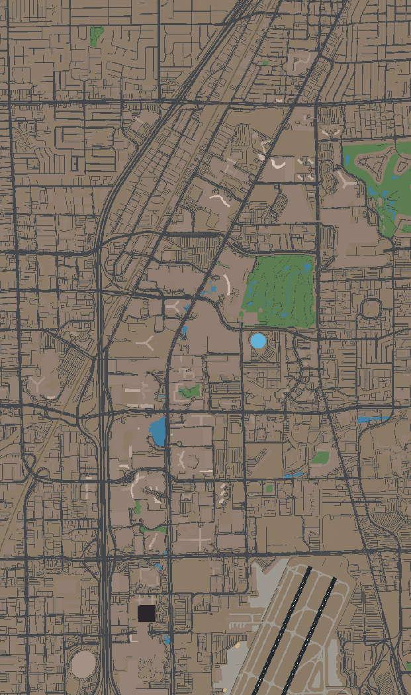
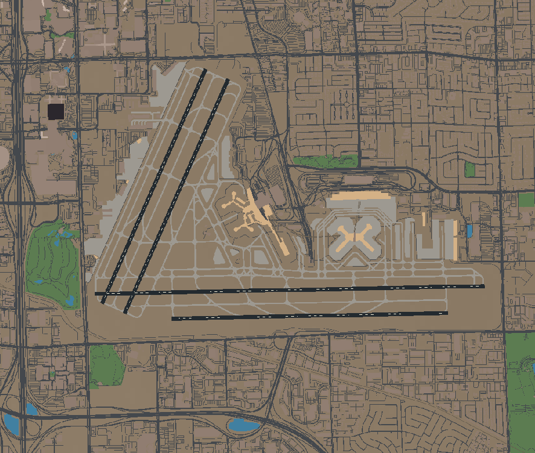
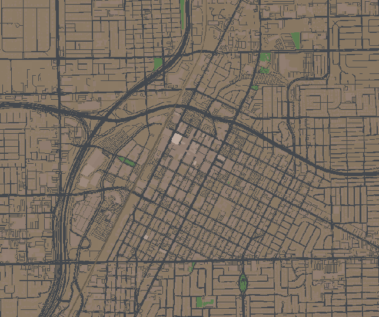
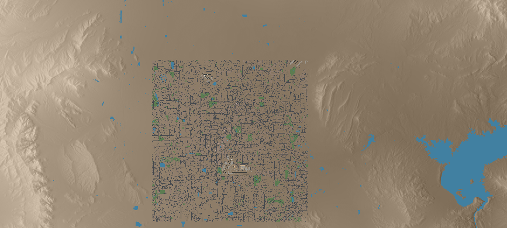

# Las Vegas

[Fly the Strip](https://xberenguer.github.io/scenic-flight/play.html?destination=las-vegas&session=215) · [Fly Harry Reid Airport](https://xberenguer.github.io/scenic-flight/play.html?destination=las-vegas&departure=airport&session=215) · [Fly downtown](https://xberenguer.github.io/scenic-flight/play.html?destination=las-vegas&departure=downtown&session=215) · [Fly past the Sphere](https://xberenguer.github.io/scenic-flight/play.html?destination=las-vegas&departure=sphere&session=215)

One world unit represents one metre. The map uses UTM Zone 11N with an origin near the Strip. It samples road and building geometry on a 6 m grid and USGS 3DEP elevation on a 60 m grid.

The first mapped area is 24 × 24.96 km. It includes the Strip, downtown, Harry Reid, and surrounding neighborhoods. The wider terrain extends across Red Rock Canyon and Lake Mead. Building and road detail ends at the current urban map boundary.

| Area | Coverage |
| --- | --- |
| Strip | Casino and hotel footprints, roadside geometry, the Sphere, the Luxor pyramid, the STRAT observation tower, monorail tracks, and the Bellagio lake |
| Airport | Four FAA runways, OpenStreetMap terminal and concourse footprints, taxiways, and aprons |
| Downtown | Property footprints and street geometry around Fremont Street and nearby districts |
| Wide valley | USGS terrain and water outlines, including Lake Mead |

Identifiable building exteriors are an ongoing pass. The renderer uses OpenStreetMap heights or storey counts where present and estimates heights elsewhere. Casino labels come from mapped points within the detailed area. The state license register is the reference for checking property coverage. The wide terrain map has a fixed outer boundary.

| Strip | Airport | Downtown |
| --- | --- | --- |
|  |  |  |



## Data and build

The importer packs the terrain and detailed area into tiles and records per-area feature counts. The preview exporter reads the same pack as the browser. [MiniWorld World Builder reference](https://x.com/marceloeduardo/status/2126028373348553058)

- Roads, buildings, and land use are from © OpenStreetMap contributors. The packed map database and its manifest are available under the Open Database License. [OpenStreetMap copyright and ODbL](https://www.openstreetmap.org/copyright) · [Nevada source extract](https://download.geofabrik.de/north-america/us/nevada.html) · [Packed map](assets/geography/las-vegas.bin.gz) · [Feature manifest](assets/geography/las-vegas.json)
- Terrain comes from USGS 3DEP. [USGS elevation service](https://elevation.nationalmap.gov/arcgis/rest/services/3DEPElevation/ImageServer)
- Harry Reid's four runway layouts use surveyed endpoints and widths from the FAA's November 26, 2026 data. [FAA airport data](https://www.faa.gov/air_traffic/flight_info/aeronav/aero_data/NASR_Subscription/2026-11-26/)
- The Sphere uses its mapped footprint and published 366 ft height and 516 ft diameter. The Luxor pyramid uses its mapped footprint and documented 106.7 m height. The STRAT model uses the mapped tower location and its published 1,149 ft height. [Sphere Entertainment annual report](https://www.sec.gov/Archives/edgar/data/1795250/000162828026007760/sphr-20251231.htm) · [Luxor Pyramid](https://www.skyscrapercenter.com/building/luxor-pyramid/13708) · [The STRAT Tower](https://thestrat.com/attractions/tower)
- Casino coverage can be cross-checked against the Nevada Gaming Control Board's public location reports. [Nevada gaming locations](https://www.gaming.nv.gov/about-us/restricted-and-nonrestricted-locations-report/)

The rebuild requires Python with `numpy`, `osmium`, `pyproj`, `rasterio`, and `shapely`.

```sh
python tools/geography/build_las_vegas.py nevada.osm.pbf elevation.tif faa-apt.zip output
python tools/geography/preview_las_vegas.py output/las-vegas.bin.gz output/maps
```
