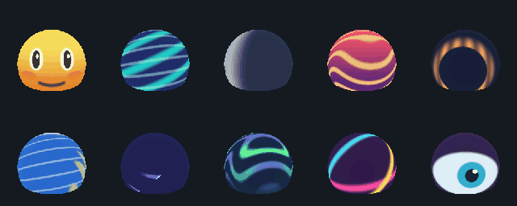
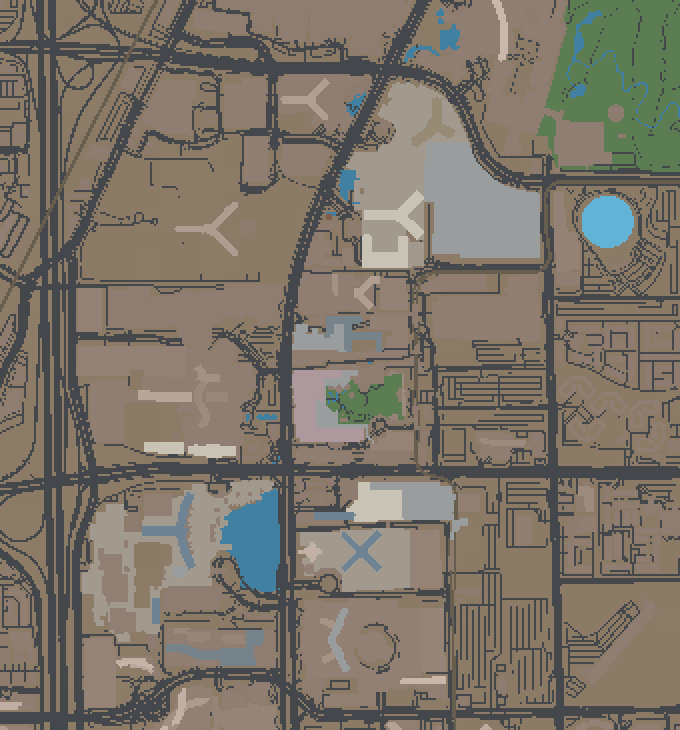

# Las Vegas

[Fly the Strip](https://xberenguer.github.io/scenic-flight/play.html?destination=las-vegas&session=215) · [Fly Harry Reid Airport](https://xberenguer.github.io/scenic-flight/play.html?destination=las-vegas&departure=airport&session=215) · [Fly downtown](https://xberenguer.github.io/scenic-flight/play.html?destination=las-vegas&departure=downtown&session=215) · [Fly past the Sphere](https://xberenguer.github.io/scenic-flight/play.html?destination=las-vegas&departure=sphere&session=215)

One world unit represents one metre. The map uses UTM Zone 11N with an origin near the Strip. It samples road and building geometry on a 6 m grid and USGS 3DEP elevation on a 60 m grid.

The first mapped area is 24 × 24.96 km. It includes the Strip, downtown, Harry Reid, and surrounding neighborhoods. The wider terrain extends across Red Rock Canyon and Lake Mead. Building and road detail ends at the current urban map boundary.

The Sphere plays ten original LED programs. Each flight begins with a seeded selection, then cycles through a blinking emoji, teal waves, the Moon, sunset ribbons, an eclipse, Earth, meteor trails, an aurora, neon rings, and a blinking eye. The High Roller has animated rim lights, the Paris balloon has a gold light chase at dusk, and Fremont Street has a flowing canopy display after dark. Allegiant Stadium and Fremont Street have their own sightseeing departures. [Sphere architect](https://populous.com/showcases/sphere) · [Viva Vision dimensions](https://fremontstreetexperience.com/about-us/) · [Allegiant Stadium roof](https://www.walterpmoore.com/perspectives/allegiant-stadium-ushers-in-new-era)



The Venetian and Palazzo departure passes the central Strip resorts. The feature manifest records 36 tower, podium, and roof components across ten properties, with their OpenStreetMap IDs and height sources. The Palazzo tower rises 196 m. The Horseshoe's lower podium is estimated from its separately mapped five-storey wings. [Component manifest](assets/geography/las-vegas.json) · [Venetian architect](https://www.watg.com/project/venetian-las-vegas-usa/) · [Palazzo project engineer](https://www.vanderweil.com/project/venetian-resort-hotel-casino-the-palazzo/) · [Bellagio architect](https://www.jerde.com/projects/7501/bellagio)

| Area | Coverage |
| --- | --- |
| Strip | Casino and hotel footprints, roadside geometry, the Sphere, the Luxor pyramid, the STRAT observation tower, the Paris Las Vegas Eiffel Tower, the High Roller, monorail tracks, and the Bellagio lake |
| Airport | Four FAA runways, OpenStreetMap terminal and concourse footprints, taxiways, and aprons |
| Downtown | Property footprints and street geometry around Fremont Street and nearby districts |
| Wide valley | USGS terrain and water outlines, including Lake Mead |

Identifiable building exteriors are an ongoing pass. The renderer uses OpenStreetMap heights or storey counts where present and estimates heights elsewhere. Casino labels come from mapped points within the detailed area. The state license register is the reference for checking property coverage. The wide terrain map has a fixed outer boundary.

| Strip | Airport | Downtown |
| --- | --- | --- |
|  |  |  |




## Data and build

The importer builds georeferenced tiles for the entire mapped area. Individual landmarks use detailed geometry anchored to those same coordinates. Dedicated flybys make it possible to inspect each landmark in game. The preview exporter reads the same pack as the browser. [MiniWorld project](https://miniworld.marceloeduardo.com/cidades/?city=tokyo)

- Roads, buildings, and land use are from © OpenStreetMap contributors. The packed map database and its manifest are available under the Open Database License. [OpenStreetMap copyright and ODbL](https://www.openstreetmap.org/copyright) · [Nevada source extract](https://download.geofabrik.de/north-america/us/nevada.html) · [Packed map](assets/geography/las-vegas.bin.gz) · [Feature manifest](assets/geography/las-vegas.json)
- Terrain comes from USGS 3DEP. [USGS elevation service](https://elevation.nationalmap.gov/arcgis/rest/services/3DEPElevation/ImageServer)
- Harry Reid's four runway layouts use surveyed endpoints and widths from the FAA's November 26, 2026 data. [FAA airport data](https://www.faa.gov/air_traffic/flight_info/aeronav/aero_data/NASR_Subscription/2026-11-26/)
- The Sphere uses its mapped footprint and published 366 ft height and 516 ft diameter. The Luxor pyramid uses its mapped footprint and documented 106.7 m height. The STRAT model uses the mapped tower location and its published 1,149 ft height. [Sphere Entertainment annual report](https://www.sec.gov/Archives/edgar/data/1795250/000162828026007760/sphr-20251231.htm) · [Luxor Pyramid](https://www.skyscrapercenter.com/building/luxor-pyramid/13708) · [The STRAT Tower](https://thestrat.com/attractions/tower)
- The Eiffel Tower has an open lattice and 541 ft height. The High Roller has a 143 m rim, 28 cabins, and a 30-minute rotation. Both are anchored to their mapped locations. Lattice, decks, and supports are modeled at simplified detail. [Paris Las Vegas fact sheet](https://newsroom.caesars.com/files/doc_downloads/2025/04/Paris-Las-Vegas-Fact-Sheet_April-2025-FINAL.pdf) · [High Roller engineering report](https://www.arup.com/globalassets/downloads/arup-journal/the-arup-journal-2014-issue-2.pdf) · [High Roller cabin supplier](https://www.poma.net/en/work/the-high-roller-observation-wheel/)
- The Paris balloon sign uses the manufacturer's 180 ft height and 72 ft diameter. OpenStreetMap lists the sign at 150 ft. The Arc de Triomphe uses the mapped piers and span with an estimated 33 m height. [Balloon manufacturer](https://federalheath.com/portfolio/paris-balloon) · [Paris Las Vegas fact sheet](https://newsroom.caesars.com/files/doc_downloads/2025/04/Paris-Las-Vegas-Fact-Sheet_April-2025-FINAL.pdf)
- The Strip and downtown license audit matches property labels, links indoor services to their host venue, and identifies demolished sites and construction. [Nevada gaming locations](https://www.gaming.nv.gov/about-us/restricted-and-nonrestricted-locations-report/)

The rebuild requires Python with `numpy`, `osmium`, `pyproj`, `rasterio`, and `shapely`.

```sh
python tools/geography/build_las_vegas.py nevada.osm.pbf elevation.tif faa-apt.zip output
python tools/geography/preview_las_vegas.py output/las-vegas.bin.gz output/maps
python tools/geography/audit_vegas_casinos.py nonrestricted-locations.xlsx output/las-vegas.json output/casino-audit.tsv
python tools/geography/compact_las_vegas.py output/las-vegas.bin.gz output/las-vegas-compact.bin
```

The optional compact pack preserves every source cell and can be sampled without unpacking it into a second map buffer.
