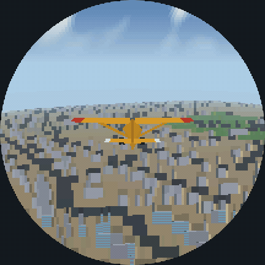
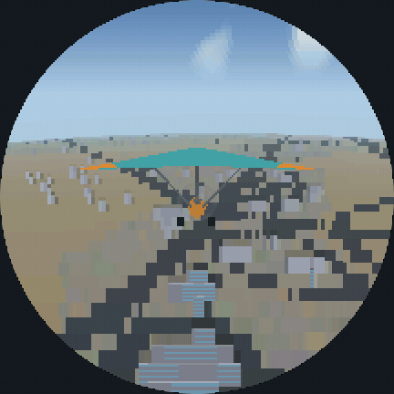
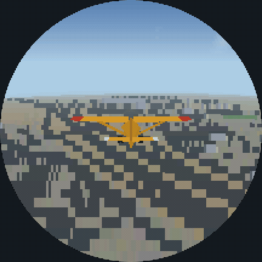
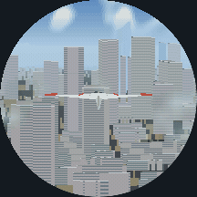
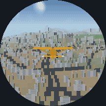
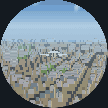
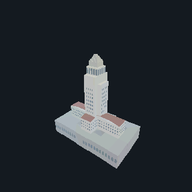
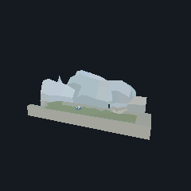

# Los Angeles

Choose **Los Angeles** under **Destination** in the browser. The twelve departures cover Downtown, Dodger Stadium, Exposition Park, Union Station, Griffith Observatory, Hollywood, Pasadena, Inglewood, LAX, Santa Monica Pier, Venice Beach, and Getty Center. [Fly Downtown Los Angeles](https://xberenguer.github.io/scenic-flight/play.html?destination=los-angeles&session=215)

Choose **Los Angeles + Las Vegas** to fly both mapped areas in one continuous world. The Las Vegas origin is 279,792 m east and 229,511 m north of the Los Angeles origin. The city centers are approximately 362 km apart. The regional ground uses a 150 m USGS elevation grid, while the mapped urban areas keep their 6 m feature grids. Scenery beyond mapped areas is generated from the flight seed, and the survey fades into the original terrain at the outer edge. [USGS 3DEP](https://www.usgs.gov/3d-elevation-program)

The Southwest highway layer uses 17,628 mapped line segments from I-15, I-10, I-605, I-210, I-215, US 95, US 395, and CA 210. Both I-15 carriageways are mapped through Baker, Mountain Pass, and Primm. Pavement and shoulder widths are estimated from lane counts. [OpenStreetMap contributors and ODbL](https://www.openstreetmap.org/copyright) · [Highway map pack](assets/geography/southwest-roads.bin.gz)

The flight passes through Barstow, Baker, and Primm in either direction. Their 4 m detail layer uses **8,902 mapped building footprints** and **3,367 road ways**, along with mapped rail, parking, parks, and Baker’s runway. Buildings without a mapped height use storey estimates or low generic forms. [Town map pack](assets/geography/southwest-towns.bin.gz)

| Barstow | Baker | Primm |
| --- | --- | --- |
|  |  |  |

The map uses UTM Zone 11N, centered near 34.0500° N, 118.2500° W. One world unit is one metre. Streets, railway lines, parks, water, and building footprints use a 6 m grid across a 48 × 48 km area around Downtown. The 60 m elevation grid spans 86.4 × 86.4 km and includes the basin, mountains, and Pacific shoreline.

Four Downtown landmarks have dedicated geometry. The U.S. Bank Tower uses five sets of mapped footprint polygons and the architect's published 1,018 ft height. Wilshire Grand Center uses its mapped podium and tower shape with a modeled sail roof and 1,100 ft spire. Façades, rooftop surfaces, and window divisions are simplified. [U.S. Bank Tower architect](https://pcfarchitects.com/projects/us-bank-tower-formerly-library-tower/) · [Wilshire Grand Center structural engineer](https://www.thorntontomasetti.com/project/wilshire-grand-center)

Los Angeles City Hall uses the mapped footprints, five light courts, red wing roofs, and a stepped 138 m tower. Walt Disney Concert Hall uses its mapped perimeter and courtyard, with individually modeled stainless-steel volumes, the Blue Ribbon Garden, an amphitheatre, and the Rose for Lilly fountain. [City Hall architectural survey](https://tile.loc.gov/storage-services/master/pnp/habshaer/ca/ca1200/ca1261/data/ca1261data.pdf) · [Concert Hall design history](https://www.getty.edu/news/rite-of-spring-frank-gehry-and-the-walt-disney-concert-hall-of-the-los-angeles-philharmonic/)

The import contains 2,003,223 building components, 479,829 road segments, 3,947 rail segments, and 3,470 park features. Building heights come from 1,829,094 mapped height tags, 4,833 floor-count estimates, and 169,296 footprint estimates. The detailed area covers 43 of the reference's 46 checkpoints. The checkpoint audit distinguishes individual mapped features from venues with general surroundings. [Checkpoint audit](assets/geography/los-angeles-checkpoints.json)

| Downtown | Griffith Park | Inglewood |
| --- | --- | --- |
| [](assets/current/la-downtown.mp4) | [](assets/current/la-griffith-observatory.mp4) | [](assets/current/la-inglewood.mp4) |

| Los Angeles City Hall | Walt Disney Concert Hall |
| --- | --- |
|  |  |

| Area | Detail scope |
| --- | --- |
| Downtown and the inner neighborhoods | Streets, surface rail, buildings, parks, mapped waterways, and dedicated landmark geometry |
| Hollywood, Griffith Park, Pasadena, and Inglewood | Mapped building footprints, streets, surface rail, parks, and the surrounding terrain |
| LAX and the Westside coast | Four mapped LAX runways, taxiways, terminal footprints, beachfront roads, and Santa Monica Pier |
| Port of Los Angeles and Long Beach | Regional shore and elevation |

At LAX the route approaches from over the Pacific. Four runway strips are visible in the packed map and were checked against the airport’s airfield plan. [LAX airfield plan](https://www.flylax.com/sites/lax/files/documents/FS%20-%20Airfield%20Feb_2021.pdf)

## Data and build

MiniWorld's Los Angeles map guided the visual study and the choice of places to check. The game uses its own georeferenced terrain and 3D geometry. [MiniWorld Los Angeles](https://miniworld.marceloeduardo.com/cidades/?city=los_angeles)

- Streets, footprints, and land use are from © OpenStreetMap contributors. The map pack and feature manifest are available under the Open Database License. [OpenStreetMap copyright](https://www.openstreetmap.org/copyright) · [Southern California extract](https://download.geofabrik.de/north-america/us/california/socal/index.html) · [Map pack](assets/geography/los-angeles.bin.gz) · [Feature manifest](assets/geography/los-angeles.json)
- The elevation grid uses USGS 3DEP. [USGS elevation service](https://elevation.nationalmap.gov/arcgis/rest/services/3DEPElevation/ImageServer)

The importer requires Python with `numpy`, `osmium`, `pyproj`, `rasterio`, and `shapely`. The detail radius rounds up to whole 96 m tiles.

```sh
python tools/geography/build_los_angeles.py socal.osm.pbf elevation.tif output --radius-m 24000
python tools/geography/build_southwest_roads.py socal.osm.pbf output/southwest-roads.bin.gz --additional-osm nevada.osm.pbf
```
