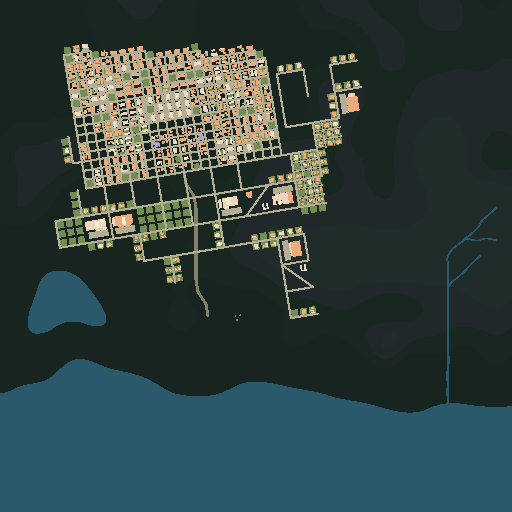
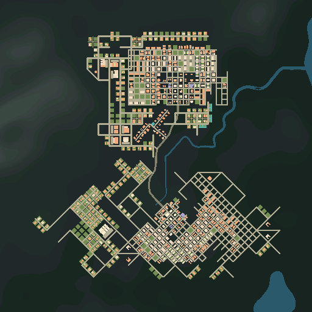
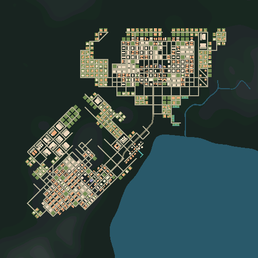
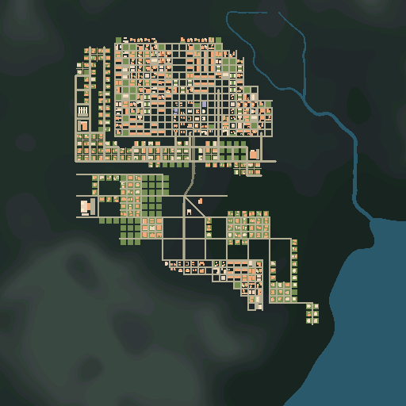
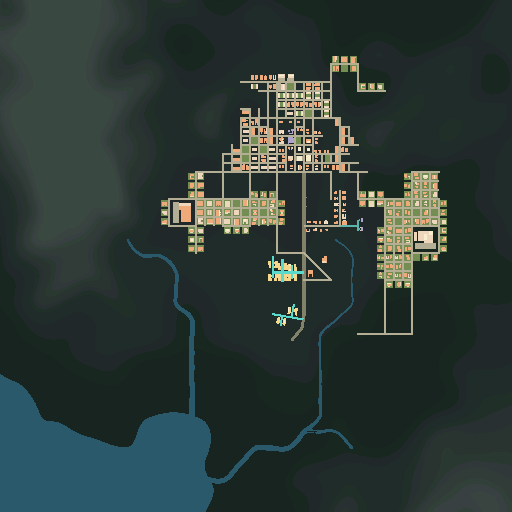
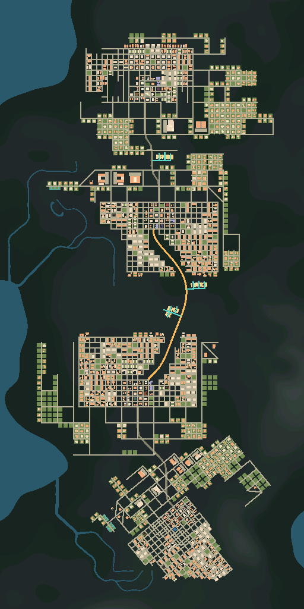

# How Scenic Flight generates a world

[Play Scenic Flight](https://xberenguer.github.io/scenic-flight/play.html) · [Gameplay and artwork](../README.md)

A world seed determines where terrain, roads, cities, airfields and coastlines form. Flight time advances the sky, weather and encounters over that layout.

## City sizes

The v0.1.120 baseline survey ran from the Racer's starting area in seeds **0–255** using the same terrain, street, waterway and settlement preparation as the flight renderer. It found **531 settlements** in 190 of those 256 starting areas. A settlement includes its core streets, subdivisions and outer boroughs. Distances are in engine world units.

| Measurement | Result |
| --- | ---: |
| Median longest side | 474 units |
| Median streets, roofs, industrial sites and parks combined | 57,120 square units |
| Longest measured settlement | 814 × 400 units |
| Largest developed footprint | 123,116 square units within 616 × 552 units |
| Road planning region | 1,024 × 1,024 units |
| Spacing between intersections in the core street grid | 18 units |
| Outer collector grid spacing | 36 or 54 units |

Developed surfaces covered about 36% of the largest measured footprint’s bounding rectangle. This was a survey of generated starting areas. The dimensions of individual towns depend on the seed and buildable land. Open land between two settlements and the highway joining them are excluded from city coverage. Measurements use a 2-unit sampling grid, so narrow roads and small roofs introduce some measurement variation. In the raw table, road end 0 is the start of the regional road and 1 is its far terminus. [Raw measurements](assets/planning/settlement-sample.tsv)

## Generated street maps

Each map shows one 1,024-unit road planning region at the same scale. Cream and orange mark rooftops, tan marks streets, lavender marks industrial buildings, green marks civic green space and blue marks water. Seed and region coordinates identify the source. Regions can contain multiple settlements.

| Seed 149 · region −6, −4 | Seed 241 · region −2, −4 |
| --- | --- |
|  |  |

| Seed 21 · region 2, 2 | Seed 24 · region −1, 5 |
| --- | --- |
|  |  |

Two more examples show [a hillside settlement](assets/planning/urban-16--3--7.png) and [an open-grid town](assets/planning/urban-15-1-0.png).

## Roads, districts and buildings

The road planner looks for pairs of dry approaches it can connect at a usable grade. A road terminus may grow into a town if its slope permits a connected street network and enough buildings. The center starts with a 7-column street grid that can reach 7 rows. It can gain hillside extensions and shift with the terrain. [Road planner](../src/roads.rs) · [Town generation](../src/settlement.rs)

The 25 neighborhood templates define where the next set of streets may grow. Each candidate street still has to connect and pass the ground checks. Farther out, wider-spaced collector roads support houses, shops, industry and open blocks. Other planned land uses, waterways and steep ground can cut gaps in the street network. When a dry approach reaches a usable shore, the same survey can site a waterfront extension. [Neighborhood templates](../src/settlement/district_layouts.rs) · [Outer boroughs](../src/settlement/expansion/boroughs.rs) · [Waterfront extensions](../src/settlement/expansion/waterfront.rs)

## Neighborhoods along highways

Across 320 starting seeds in v0.1.121, the road survey placed **148 highway neighborhoods** and produced all **25 layouts**. A collector starts at an existing road, climbs only where the grade allows, and grows side streets and buildable lots. The layouts include cottage rows, duplex courts, shops, workshops, and mixed-use streets. The survey leaves unsuitable ground undeveloped.

Published highways can provide new street connections across planning regions. Each roadside neighborhood reserves its own street and lots inside its region. The highway joins the regions through the existing road network.

In the examples below, cyan marks the added streets and gold marks their homes and shops.

| Shops and duplexes · seed 18 | Workshops and village streets · seed 33 |
| --- | --- |
|  |  |

[Frontage planner](../src/settlement/frontage.rs) · [Layout atlas](assets/artwork/frontage-layouts.png)

## A road between two towns

When a regional road's regular end cannot reach the next town, the survey can try the outer ends of streets already connected to each town center. These routes keep their terrain grade and reserve ground around buildings, waterways, and other infrastructure. The planner tests 26 different alignments before choosing a route that fits.

The map below shows seed 93. The accepted highway is about **575 world units** between the two street connections and crosses the boundary between the two surveyed regions.

[Road alignment atlas](assets/artwork/town-road-alignments.png) · [Highway planner](../src/highway_links.rs)

## Local building finishes

Civic landmarks use finishes selected from local terrain. Coastal areas favor whitewash, blue roofs, slate, and weathered finishes. Dry inland districts favor clay and sandstone. Upland areas use stone, slate, and weathered wood tones. The town and riverfront atlases show 50 individual roof and wall combinations.

## What can appear where

| System | Placement |
| --- | --- |
| Terrain and ground cover | Elevation and climate shape coasts, open land, forest, rock, desert and snow cover. Plants and ground details vary with habitat, land form and seed. [Terrain](../src/world.rs) · [Ground details](../src/ground_details.rs) |
| Rivers and alpine lakes | Drainage follows the terrain. The regional river planner places banks and crossings where they fit. Alpine lake basins have their own survey. [Watersheds](../src/watershed.rs) · [Alpine lakes](../src/alpine_lakes.rs) |
| Ports, vessels and lighthouses | Port candidates need a coastal road approach, compatible shoreline, enough water depth and a pier site. Moorings and lighthouse headlands use separate coastal surveys. [Ports](../src/ports.rs) · [Anchorages](../src/maritime.rs) · [Lighthouses](../src/lighthouses.rs) |
| Airfields | Country strips need enough open, suitable ground for a runway. Regional airfields also plan their access from the road network. [Airfields](../src/airfield.rs) |
| Rail and industry | Regional rail corridors join suitable endpoints and can serve quarries, terminals and stations. Trains follow the surveyed corridors. [Rail surveys](../src/rail_survey.rs) · [Regional rail](../src/rail_stream.rs) |
| Sky and weather | The sun follows a seasonal path. The Moon changes phase. Local cloud cover, haze and elevation affect which showers form and where they fall as snow. Individual flakes fall through each snow band. [Sky](../src/sky.rs) · [Precipitation](../src/weather_effects.rs) |

## Where a flight starts

The launch survey scores headings and positions for land, relief, terrain ahead and the aircraft's clearance. Some coastal starts are retained. If the aircraft would spend too long leaving open water, the survey can look farther away for land. Eligible flights can start on a town approach when a suitable town is already prepared. The Blackbird starts at high altitude. [Aircraft and launch survey](../src/flight.rs)
